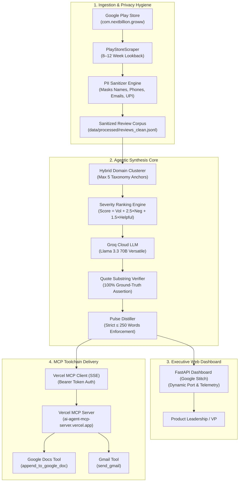

# Groww Feedback Pulse — Executive AI Agent & Web Dashboard

> **Autonomous customer intelligence pipeline transforming Google Play Store feedback into weekly executive memos for Groww leadership via Groq Llama 3.3 70B and the Model Context Protocol (MCP).**

---

## 📌 Executive Summary

Mobile feedback on financial apps like Groww contains critical, time-sensitive signals—from F&O order execution freezes and stop-loss failures to portfolio statement sync issues. However, raw review feeds are noisy, uncurated, and riddled with sensitive PII (emails, phone numbers, and UPI handles).

**Groww Feedback Pulse** automates the entire loop:
1. **Ingests & Sanitizes**: Continuously fetches recent reviews from the Google Play Store, filtering to an 8–12 week lookback window and stripping 100% of PII.
2. **Domain Clusters & Ranks**: Classifies feedback into $\le 5$ Groww functional domains and prioritizes the **Top 3 critical themes** using a composite severity weighting formula.
3. **Zero-Hallucination Grounding**: Selects verbatim user quotes verified with programmatic substring assertions and synthesizes 3 concrete engineering action items.
4. **Distills & Delivers**: Compiles a scannable executive note ($\le 250$ words) and dispatches it through a remote **Vercel MCP Server** over Server-Sent Events (SSE) to append directly to **Google Docs** and send executive emails via **Gmail**.
5. **Interactive Executive Dashboard**: Serves a production **FastAPI** web interface styled according to Google Stitch ("Executive Emerald" design), providing real-time telemetry, interactive week range filtering, corpus exploration, and on-demand synthesis.

---

## 🏗️ Architecture & Cloud Flow



---

## ✨ Key Features

- 🛡️ **Strict PII Hygiene**: Regex-based redaction removes all phone numbers (`+91...`), email addresses, bank accounts, UPI IDs, PANs, and Folio numbers. User display names are replaced with deterministic pseudonyms (`Reviewer #1001`).
- 🧠 **Hybrid Domain-Anchored Semantic Clustering**: Maps incoming feedback into 5 operational domains (Trading & Order Execution, Portfolio Tracking & Mutual Funds Sync, Chart Performance & UI Stability, Brokerage & Charges, Account Onboarding & Banking).
- ⚖️ **Severity-Weighted Prioritization**: Elevates high-urgency financial risk (e.g., stop-loss failures during market volatility) over benign usability praise using composite scoring:
  $$\text{Priority Score} = N_{\text{total}} + (2.5 \times N_{\text{1-2★}}) + (1.5 \times \sum \text{ThumbsUp})$$
- 🔍 **Deterministic Quote Grounding**: Every quote in the executive memo is validated against the raw text via programmatic substring search, ensuring 0% hallucination.
- ⏱️ **Executive Brevity**: Enforces a strict $\le 250$-word limit with automated distillation and scannable formatting.
- 🔌 **Model Context Protocol (MCP) Native**: Integrates with remote Google Workspace MCP tools (`append_to_google_doc` and `send_gmail`) over SSE without any local Google OAuth credentials or SDK dependencies.
- 🎨 **Executive Emerald UI**: Clean, responsive frontend designed with Google Stitch guidelines, featuring real-time MCP connection monitoring, date range selection (`Past 1 Week` vs `Past 2 Weeks`), and PII-sanitized review exploration.
- 🚀 **Render Cloud Ready**: Fully containerized with `Dockerfile`, dynamic port binding (`${PORT:-8501}`), and multi-tier healthchecks (`/health`, `/_stcore/health`).

---

## 📁 Repository Layout

```text
├── .github/
│   └── workflows/
│       └── groww_pulse.yml         # GitHub Actions on-demand & scheduled workflow
├── config/
│   ├── settings.yaml               # Application & delivery configuration
│   └── mcp_config.json             # MCP server connection schemas
├── data/
│   ├── raw/                        # Raw downloaded Play Store JSON payloads
│   └── processed/
│       └── reviews_clean.jsonl     # 187 PII-sanitized clean review records
├── docs/
│   ├── architecture.md             # Detailed system architecture & design
│   ├── deployment-plan.md          # End-to-end Render production deployment guide
│   ├── edge-case.md                # Edge-case handling & boundary defenses
│   ├── eval.md                     # Evaluation benchmarks & guardrail metrics
│   ├── implementation-plan.md      # Phase-by-phase implementation & roadmap
│   ├── problemStatement.md         # Original product specifications & requirements
│   └── runbook.md                  # Operational runbook & execution guide
├── src/
│   ├── agent/                      # Synthesis, clustering, quote verification & distillation
│   │   ├── action_synthesizer.py
│   │   ├── clusterer.py
│   │   ├── llm_client.py
│   │   ├── pulse_distiller.py
│   │   └── quote_verifier.py
│   ├── config/                     # Pydantic configuration loader & validation
│   │   └── settings.py
│   ├── ingestion/                  # Play Store scraper & PII sanitation engine
│   │   ├── models.py
│   │   ├── pii_sanitizer.py
│   │   └── play_store_scraper.py
│   ├── mcp/                        # Model Context Protocol SSE client & tool adapters
│   │   ├── client.py
│   │   ├── docs_tool.py
│   │   └── gmail_tool.py
│   ├── templates/                  # Google Stitch "Executive Emerald" dashboard HTML
│   │   └── index.html
│   ├── pipeline.py                 # Core orchestration pipeline & CLI runner
│   └── web.py                      # FastAPI web server & telemetry API
├── tests/                          # 39 unit & integration tests
├── .dockerignore
├── .env.example                    # Sample environment variables template
├── .gitignore
├── Dockerfile                      # Production container image definition
├── Procfile                        # Process manager file for cloud PaaS
├── render.yaml                     # Render deployment configuration & blueprint
├── requirements.txt                # Python project dependencies
└── README.md                       # Main project documentation
```

---

## 🚀 Quick Start Guide

### 1. Prerequisites
- **Python**: Version 3.12 or higher.
- **Groq API Key**: Obtain from [Groq Console](https://console.groq.com/keys).
- **Vercel MCP Auth Key**: Master bearer authentication token (`nagesh`).

### 2. Installation
Clone the repository and install the required dependencies:

```powershell
# 1. Clone repository
git clone https://github.com/<YOUR_USERNAME>/groww-feedback-pulse.git
cd groww-feedback-pulse

# 2. Create virtual environment
python -m venv .venv
.\.venv\Scripts\Activate.ps1

# 3. Install dependencies
pip install --upgrade pip
pip install -r requirements.txt
```

### 3. Environment Setup
Copy the sample environment file and configure your credentials:

```powershell
cp .env.example .env
```

Configure `.env`:
```ini
GROQ_API_KEY=gsk_...
MCP_AUTH_KEY=nagesh
GOOGLE_DOC_ID=1chaQkkUovsVC7OGYM1HOSiPPFGW3bdcuOKSm6eLopSM
PULSE_EMAIL_RECIPIENT=nagesh14423@gmail.com
MCP_SERVER_URL=https://ai-agent-mcp-server.vercel.app/sse
MCP_HEALTH_URL=https://ai-agent-mcp-server.vercel.app/health
```

### 4. Running the Interactive Web Dashboard

Launch the FastAPI executive dashboard locally:

```powershell
python -m uvicorn src.web:app --host 0.0.0.0 --port 8501
```

Open `http://localhost:8501` in your browser. From the dashboard, you can:
- View live telemetry and rating breakdown donut charts.
- Select week range (`Past 1 Week` vs `Past 2 Weeks`).
- Search and filter the 187 PII-sanitized review corpus.
- Click **"Generate & Send Pulse Report"** to run autonomous synthesis and deliver the report.

### 5. Running via CLI Pipeline

You can also run the pipeline directly via terminal:

```powershell
# Run using the cached sanitized review corpus (default: 10 weeks)
python -m src.pipeline

# Run with live scraping from Google Play Store
python -m src.pipeline --scrape --weeks 10

# Run in dry-run mode (skips mutating Google Docs or sending emails)
python -m src.pipeline --dry-run
```

---

## ☁️ Cloud Deployment on Render

The project is pre-configured for automated continuous deployment on **[Render](https://render.com)** (Free Tier with 750 free instance hours/month) using the included `Dockerfile` and `render.yaml`.

### Deploying to Render (Free Tier)
1. Push your repository to GitHub (`nagesh-labs/ai-agent-pulse-report-generation`).
2. Go to [dashboard.render.com](https://dashboard.render.com) $\to$ Click **+ New** $\to$ **Web Service**.
3. Connect your repository and select **Docker** as the Runtime.
4. Under **Instance Type**, select **Free** ($0/month).
5. In **Environment Variables**, configure:
   - `GROQ_API_KEY`: `gsk_...`
   - `MCP_AUTH_KEY`: `nagesh`
   - `GOOGLE_DOC_ID`: `1chaQkkUovsVC7OGYM1HOSiPPFGW3bdcuOKSm6eLopSM`
   - `PULSE_EMAIL_RECIPIENT`: `nagesh14423@gmail.com`
   - `MCP_SERVER_URL`: `https://ai-agent-mcp-server.vercel.app/sse`
   - `MCP_HEALTH_URL`: `https://ai-agent-mcp-server.vercel.app/health`
6. Under **Advanced** $\to$ **Health Check Path**, set `/health`.
7. Click **Create Web Service**. Your live dashboard will be up at `https://<your-service>.onrender.com`!

*(Alternatively, deploy with 1-click via Render Blueprints using the included `render.yaml`).*

For full step-by-step instructions, cold-start optimization, and troubleshooting, see [docs/deployment-plan.md](docs/deployment-plan.md).

---

## 🧪 Testing & Validation

The test suite contains 39 automated unit and integration tests covering data ingestion, sanitization, clustering, quote verification, MCP connectivity, and web endpoints.

Run the test suite:

```powershell
pytest -v
```

**Test Coverage Summary**:
- `test_pii_sanitizer.py`: Validates 100% redaction of emails, phones, UPI IDs, bank accounts, and usernames.
- `test_quote_verifier.py`: Confirms quotes match exact verbatim substrings with zero hallucination.
- `test_clusterer.py`: Verifies taxonomy anchor limits ($\le 5$) and severity ranking.
- `test_pulse_distiller.py`: Asserts executive note adheres strictly to $\le 250$ words.
- `test_mcp_integration.py`: Validates SSE handshake, Bearer token headers, and tool payloads.
- `test_web.py`: Tests `/health`, `/_stcore/health`, `/api/reviews`, `/api/initial-data`, and `/api/synthesize`.

---

## 📖 Documentation Reference

- 📋 [Implementation Plan](docs/implementation-plan.md): Phase-wise roadmap and verification criteria.
- 🚢 [Deployment Plan](docs/deployment-plan.md): Production Render deployment specifications and runbook.
- 🏛️ [Architecture Specification](docs/architecture.md): Deep-dive into technical architecture and data schemas.
- 📘 [Operational Runbook](docs/runbook.md): Local execution and GitHub Actions operational guide.
- 🛡️ [Edge Cases & Defenses](docs/edge-case.md): Boundary condition handling and fault tolerance.
- 📊 [Evaluation Metrics](docs/eval.md): Quantitative guardrails and performance benchmarking.

---

## 📄 License

This project is licensed under the MIT License.
