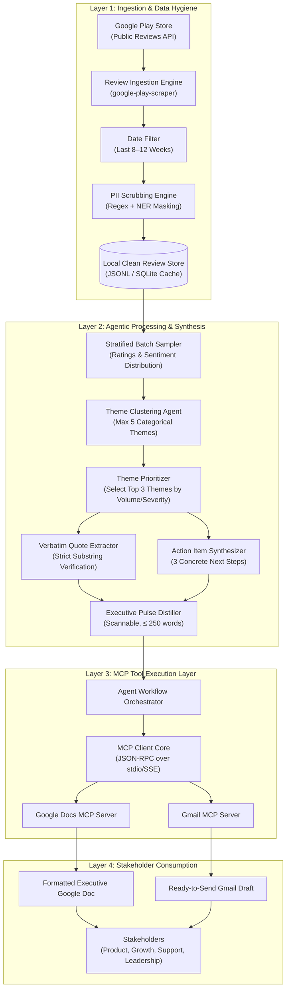
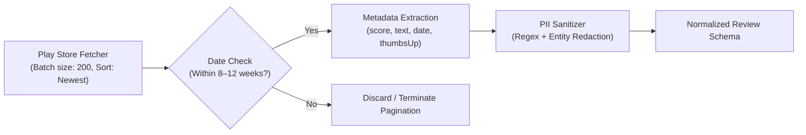
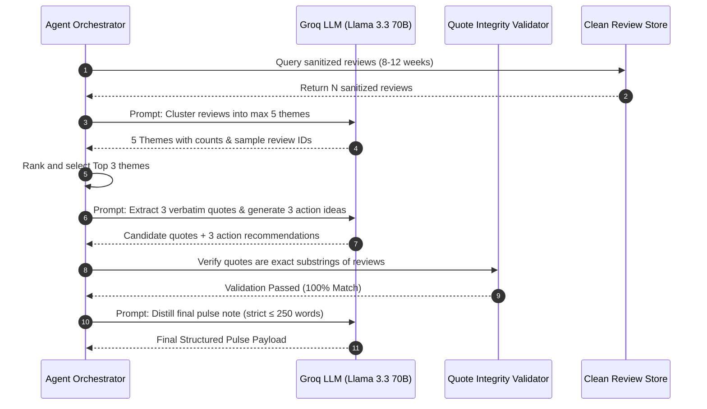
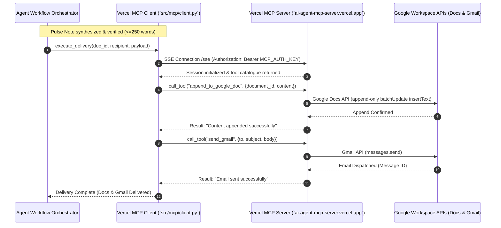
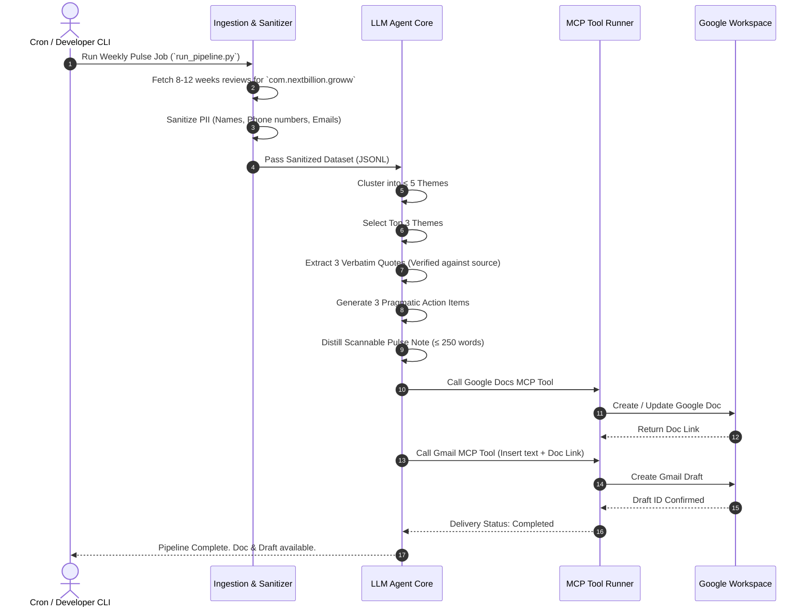

# System Architecture: Mobile App Feedback Pulse (Groww)

## 1. Architectural Overview & Design Philosophy

The **Mobile App Feedback Pulse** system is an autonomous AI agent pipeline designed to convert unstructured, high-volume Google Play Store reviews for the **Groww** platform (`com.nextbillion.groww`) into a concise, high-impact weekly executive pulse.

### Core Architectural Principles
1. **MCP-First Integration**: All interactions with external enterprise tools (Google Docs and Gmail) occur strictly via the **Model Context Protocol (MCP)**. No bespoke OAuth2 clients or REST API client code are implemented for Google Workspace services.
2. **Deterministic Data Integrity**: Strict validation ensures that verbatim quotes are exact substrings of real user reviews, completely eliminating LLM hallucinations.
3. **Zero-PII Privacy Barrier**: A dedicated pre-processing sanitization layer strips all personal identifiers (usernames, phone numbers, emails, order/folio numbers) before text enters LLM prompts or output artifacts.
4. **Scannability & Brevity**: Enforced truncation and concise prompt templates guarantee that the synthesized note adheres strictly to the $\le$ 250-word constraint.

---

## 2. High-Level System Architecture



---

## 3. Subsystem Breakdown

### 3.1 Layer 1: Ingestion & Data Hygiene Subsystem

The Ingestion Subsystem collects public store reviews and strips sensitive attributes before LLM consumption.



#### Key Components:
- **`ReviewFetcher`**: Uses `google-play-scraper` to pull reviews for package `com.nextbillion.groww` with pagination until the boundary date (8–12 weeks prior) is reached.
- **`QualityFilters`**:
  - **Length Filter**: Strictly filters out short reviews ($\le 8$ words) to retain only substantive, informative feedback.
  - **Emoji Stripper**: Removes all Unicode emojis while preserving currency symbols (`₹`) and punctuation.
  - **Language Filter**: Keeps verified English reviews; automatically detects and discards Devanagari, regional Indic scripts (Tamil, Telugu, Kannada), and romanized Hindi/Hinglish.
- **`PIISanitizer`**:
  - Removes email addresses (`[\w\.-]+@[\w\.-]+\.\w+`) and de-obfuscates `[at]`, `[dot]`.
  - Removes 10-digit Indian mobile numbers (`[6-9]\d{9}`) and spaced digit patterns.
  - Removes banking identifiers (UPI VPAs, PAN cards, and 16-digit Demat/bank accounts).
  - Strips reviewer display names; replaces reviewer identity with anonymous identifiers (e.g., `Reviewer #0042`).

---

### 3.2 Layer 2: Agentic Analysis & Synthesis Subsystem

This subsystem performs thematic analysis, quote extraction, and synthesis under strict constraints.



#### 1. Theme Clustering (Max 5 Domain Taxonomy Anchors)
The clustering engine binds reviews into at most 5 predefined operational domains tailored for Groww:
1. **Trading & Order Execution (F&O / Intraday)**: Stop-loss not triggering, "adapter disconnected" errors on exit, order placement latency, position freezing during market volatility.
2. **Portfolio Tracking & Mutual Funds Sync**: CAMS statement reconciliation failure, incorrect XIRR calculations (-45%), SIP redemption delays, mutual fund display mismatches.
3. **Chart Performance & App UI Stability**: Chart loading failures ("failed to load"), line vs candlestick chart de-sync, Android vs iOS preview offset feature disparity, missing tablet landscape mode.
4. **Brokerage, Charges & Transparency**: High F&O brokerage disputes, unexpected charges on mobile number updates or auto-square-off, fee clarity.
5. **Account Onboarding, IPO & Banking**: IPO allotment transparency/disappointment, UPI ID change friction, bank account linking (SBI for US wallet), permission/PAN objections.

#### 2. Theme Selection & Quote Extraction
- **Severity-Weighted Ranking Formula**: Selects the **Top 3 themes** via a deterministic composite score:
  $$\text{Priority Score} = N_{\text{total}} + \left(2.5 \times N_{\text{1-2★}}\right) + \left(1.5 \times \sum \text{ThumbsUp}\right)$$
  This guarantees that high-urgency financial risk and order execution failures receive executive visibility over benign high-volume feedback.
- **Verbatim Quote Extraction**: Extracts **exactly 3 verbatim user quotes** (one per top theme).
- **Quote Integrity Guardrail**: The system runs a programmatic substring check:
  $$\text{quote} \in \text{review\_text}$$
  If the candidate quote does not match verbatim, the agent retries or falls back to an exact sliced sentence from the source review.

#### 3. Action Ideation
- Synthesizes **3 concrete, engineering/product-actionable steps** directly addressing the Top 3 themes.

#### 4. Word-Count Enforcer
- The pulse note text is constrained to **$\le$ 250 words**. A post-generation token/word validator validates word count before triggering delivery.

---

### 3.3 Layer 3: MCP Integration & Delivery Subsystem

This subsystem delivers the finalized pulse note to stakeholders using the remote Google Workspace MCP Server deployed on **Vercel** (`https://ai-agent-mcp-server.vercel.app`) using Server-Sent Events (SSE) transport.



#### MCP Integration Specifications:
- **Server Deployment**: Cloud-hosted on Vercel at `https://ai-agent-mcp-server.vercel.app` (Source: [`https://github.com/nagesh-labs/ai-agent-mcp-server.git`](https://github.com/nagesh-labs/ai-agent-mcp-server.git)).
- **Transport**: Standard Model Context Protocol (MCP) over **Server-Sent Events (SSE)** via `/sse` and `/messages/`.
- **Security**: Guarded by `ApiKeyAuthMiddleware` requiring `Authorization: Bearer <MCP_AUTH_KEY>`.
- **Zero Direct OAuth/REST API Code**: No bespoke Google API client code is implemented in the agent pipeline; all Workspace interactions are strictly delegated to the MCP server.
- **Tools Invoked**:
  1. `append_to_google_doc`: Appends the weekly pulse note to the master stakeholder Google Doc (`document_id`, `content`).
  2. `send_gmail`: Sends an executive email containing the pulse note text and Google Doc pointer directly to the configured stakeholder alias (`to`, `subject`, `body`).

---

## 4. End-to-End Execution Sequence



---

## 5. Data Models & Schemas

### 5.1 Review Data Model
```python
from pydantic import BaseModel, Field
from datetime import datetime
from typing import Optional

class ReviewRecord(BaseModel):
    review_id: str
    user_name_anonymized: str = Field(description="Anonymous label, e.g. Reviewer #42")
    rating: int = Field(ge=1, le=5)
    title: Optional[str] = None
    text: str = Field(description="Sanitized review text without PII")
    date: datetime
    thumbs_up_count: int = 0
    app_version: Optional[str] = None
```

### 5.2 Pulse Note Output Schema
```python
from pydantic import BaseModel, Field
from typing import List

class ThemeSummary(BaseModel):
    name: str = Field(description="Name of theme, e.g. Funds & Withdrawal Delays")
    sentiment_ratio: float = Field(description="Percentage of negative/critical reviews in theme")
    review_count: int = Field(description="Volume of reviews tagged with this theme")
    verbatim_quote: str = Field(description="Exact substring quote from a real user review")

class WeeklyPulseNote(BaseModel):
    date_range: str = Field(description="e.g., Aug 10, 2026 – Oct 31, 2026")
    total_reviews_analyzed: int
    top_themes: List[ThemeSummary] = Field(max_items=3, min_items=3)
    action_ideas: List[str] = Field(max_items=3, min_items=3, description="3 concrete engineering/product steps")
    word_count: int = Field(le=250, description="Strict total word count limit")
    google_doc_url: Optional[str] = None
```

---

## 6. Directory & Codebase Structure

To maintain a clean separation of concerns, the project follows this modular layout:

```
c:\GenAI_Projects\Milestone-AI Agents\
│
├── docs\
│   ├── problemStatement.txt         # Original requirements document
│   ├── problemStatement.md          # Formatted project problem statement
│   └── architecture.md              # Complete system architecture specification
│
├── config\
│   ├── mcp_config.json              # MCP server configurations (Docs & Gmail)
│   └── settings.yaml                # Pipeline hyperparameters (date ranges, word limits)
│
├── data\
│   ├── raw\                         # Raw cached exports (gitignored)
│   └── processed\                   # PII-sanitized review records (JSONL)
│
├── src\
│   ├── __init__.py
│   ├── ingestion\
│   │   ├── __init__.py
│   │   ├── play_store_scraper.py    # Review retrieval for com.nextbillion.groww
│   │   └── pii_sanitizer.py         # Regex + entity redaction engine
│   │
│   ├── agent\
│   │   ├── __init__.py
│   │   ├── clusterer.py             # Thematic clustering engine (max 5 themes)
│   │   ├── quote_verifier.py        # Substring verification for zero-hallucination
│   │   ├── pulse_distiller.py       # Summarizer enforcing ≤ 250 words
│   │   └── prompts.py               # Optimized, tested prompt templates
│   │
│   ├── mcp\
│   │   ├── __init__.py
│   │   ├── client.py                # Generic MCP JSON-RPC client
│   │   ├── docs_tool.py             # Google Docs MCP adapter
│   │   └── gmail_tool.py            # Gmail MCP adapter
│   │
│   └── pipeline.py                  # End-to-end workflow runner & CLI entrypoint
│
├── tests\
│   ├── test_pii_sanitizer.py        # PII redaction regression test suite
│   ├── test_quote_verifier.py       # Verbatim quote substring validation tests
│   ├── test_pulse_distiller.py      # Word count & schema output unit tests
│   └── test_mcp_integration.py      # Mocked MCP server tool call tests
│
├── requirements.txt                 # Dependencies (google-play-scraper, pydantic, etc.)
└── README.md                        # Quickstart instructions and setup guide
```

---

## 7. Security, Privacy & Compliance Matrix

| Area | Threat / Risk | Mitigation Strategy | Enforcement Mechanism |
| :--- | :--- | :--- | :--- |
| **Privacy / PII** | Leakage of customer names, email, phone numbers, or folio IDs into generated documents. | Two-stage PII scrubbing before any LLM ingestion. Anonymize user handles with pseudo-identifiers. | Automated regex + test suite in `src/ingestion/pii_sanitizer.py`. |
| **Store Terms (ToS)** | Account bans or legal risks from unauthorized store scraping behind logins. | Utilize standard public API endpoints (`google-play-scraper`) without credentials or private sessions. | Strict policy: public reviews only. |
| **Hallucination** | LLM inventing plausible-sounding user quotes instead of real feedback. | Quote verification engine compares candidate quotes against clean review corpus. | Programmatic assertion: `quote in corpus_text` before generation completes. |
| **Brevity Breach** | Generated pulse exceeds executive attention span (> 250 words). | Token-bounded prompt output and word-count checking before MCP transmission. | Strict word counter: rejects & re-prompts if word count > 250. |
| **Auth & Security** | Credential leakage from managing custom Google OAuth secrets in code. | Delegate all authentication and execution to trusted MCP servers. | Zero OAuth code or client secrets stored in project repository. |

---

## 8. Technology Stack

- **Runtime**: Python 3.10+
- **Data Ingestion**: `google-play-scraper`
- **Validation & Schema**: `pydantic` v2
- **Agent Orchestration**: Groq Cloud API (Llama 3.3 70B Versatile) with structured JSON output enforcement
- **Protocol Layer**: Model Context Protocol (MCP) Python SDK
- **Integrations**:
  - Google Docs MCP Server
  - Gmail MCP Server
- **Testing**: `pytest`, `pytest-mock`

