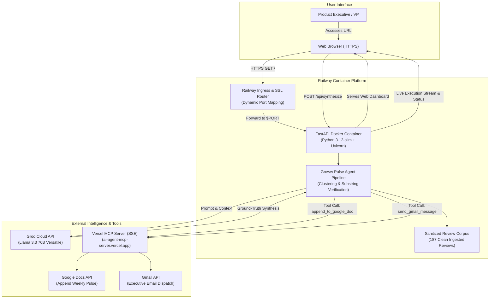

# Production Deployment Plan: Groww Feedback Pulse on Railway

This document outlines the end-to-end production deployment strategy for hosting the **Groww Feedback Pulse Executive Dashboard & AI Agent** on [Railway](https://railway.com).

---

## 1. Executive Summary & Objective

The **Groww Feedback Pulse** application is a production-ready AI intelligence system that transforms unfiltered customer feedback from Google Play Store into executive weekly memos for Groww leadership. It features an interactive **FastAPI** web dashboard styled with Google Stitch ("Executive Emerald" aesthetic) and an autonomous **Groq Llama 3.3 70B** agent pipeline communicating with a remote **Vercel MCP Server** over Server-Sent Events (SSE) to update Google Docs and dispatch executive emails.

### Key Deployment Objectives:
- **Cloud Platform**: Railway (Containerized PaaS with continuous GitHub deployment).
- **Service Type**: Web Service running FastAPI / Uvicorn in Docker.
- **Dynamic Port Binding**: Auto-configured by Railway via `${PORT:-8501}`.
- **Zero-Downtime Rolling Deploys**: Verified by automated healthchecks (`/health`).
- **External Dependencies**:
  - Remote Vercel MCP Server: `https://ai-agent-mcp-server.vercel.app/sse`
  - Target Google Doc: `1chaQkkUovsVC7OGYM1HOSiPPFGW3bdcuOKSm6eLopSM`
  - Email Recipient: `nagesh14423@gmail.com`
  - Groq Cloud API: `llama-3.3-70b-versatile`

---

## 2. Cloud Architecture Flow



---

## 3. Containerization & Repository Assets

The project includes pre-configured deployment artifacts adhering strictly to production cloud container standards:

### 3.1 `Dockerfile`
- **Base Image**: `python:3.12-slim` for minimal container footprint (<150MB).
- **System Tools**: Installs `curl` for container-level healthchecks.
- **Port Exposure**: Dynamic `$PORT` binding via `sh -c "uvicorn src.web:app --host 0.0.0.0 --port ${PORT:-8501}"`.
- **Healthcheck**: 30-second interval testing `http://127.0.0.1:${PORT:-8501}/health`.

### 3.2 `railway.json`
Specifies declarative build and deploy instructions for Railway's orchestration engine:
```json
{
  "$schema": "https://railway.app/railway.schema.json",
  "build": {
    "builder": "DOCKERFILE"
  },
  "deploy": {
    "startCommand": "sh -c \"uvicorn src.web:app --host 0.0.0.0 --port ${PORT:-8501}\"",
    "healthcheckPath": "/health",
    "healthcheckTimeout": 120,
    "restartPolicyType": "ON_FAILURE",
    "restartPolicyMaxRetries": 3
  }
}
```

### 3.3 `Procfile`
Provides standard process declaration:
```text
web: sh -c "uvicorn src.web:app --host 0.0.0.0 --port ${PORT:-8501}"
```

### 3.4 `.dockerignore`
Prevents local artifacts, virtual environments, `.git` histories, and sensitive `.env` files from leaking into the container image:
```text
.git/
.venv/
venv/
__pycache__/
*.pyc
.pytest_cache/
tests/
.env
.env.local
```

---

## 4. Prerequisites

Before deploying to Railway, ensure you have:
1. **GitHub Account**: A GitHub account with permissions to create or push repositories.
2. **Railway Account**: An active account at [railway.com](https://railway.com) (sign in using GitHub).
3. **Groq Cloud API Key**: Valid API key from [Groq Console](https://console.groq.com/keys) (`gsk_...`).
4. **Vercel MCP Auth Key**: Master bearer authentication token (`nagesh`).
5. **Google Workspace Identifiers**:
   - Target Google Doc ID: `1chaQkkUovsVC7OGYM1HOSiPPFGW3bdcuOKSm6eLopSM`
   - Executive Email Recipient: `nagesh14423@gmail.com`

---

## 5. Step-by-Step Deployment Instructions

### Method A: Deploy via GitHub (Recommended for CI/CD)

#### Step 1: Push Local Code to GitHub
If you have not yet linked a remote GitHub repository, run the following commands:

```powershell
# 1. Initialize git (already initialized in this repo)
git status

# 2. Add your GitHub remote (replace with your repository URL)
git remote add origin https://github.com/<YOUR_GITHUB_USERNAME>/groww-feedback-pulse.git

# 3. Commit any pending updates
git add .
git commit -m "feat: complete production readiness for Railway deployment"

# 4. Push to main branch
git branch -M main
git push -u origin main
```

#### Step 2: Create a New Project on Railway
1. Navigate to the [Railway Dashboard](https://railway.com/dashboard).
2. Click **+ New Project**.
3. Select **Deploy from GitHub repo**.
4. Choose your repository: `groww-feedback-pulse` (grant Railway GitHub repository access if prompted).
5. Click **Deploy Now** (Railway will begin initial provisioning).

#### Step 3: Configure Environment Variables
1. Click on the newly created service card in your Railway project canvas.
2. Go to the **Variables** tab.
3. Click **+ New Variable** (or **Raw Editor**) and add the following required keys:

| Variable Name | Value | Purpose |
| :--- | :--- | :--- |
| `GROQ_API_KEY` | `gsk_...` | Groq Cloud API key for Llama 3.3 70B inference |
| `MCP_AUTH_KEY` | `nagesh` | Master authorization token for Vercel MCP Server |
| `GOOGLE_DOC_ID` | `1chaQkkUovsVC7OGYM1HOSiPPFGW3bdcuOKSm6eLopSM` | Target Google Doc ID for pulse reports |
| `PULSE_EMAIL_RECIPIENT` | `nagesh14423@gmail.com` | Target recipient email address |
| `MCP_SERVER_URL` | `https://ai-agent-mcp-server.vercel.app/sse` | MCP Server SSE endpoint |
| `MCP_HEALTH_URL` | `https://ai-agent-mcp-server.vercel.app/health` | MCP Server healthcheck endpoint |
| `SETTINGS_FILE` | `config/settings.yaml` | Application configuration profile |
| `MCP_CONFIG_FILE` | `config/mcp_config.json` | MCP client tool configuration |

*(Note: Do **NOT** set `PORT` manually. Railway dynamically sets `PORT` to an internal container port and maps it to public HTTPS port 443).*

#### Step 4: Generate Public Domain
1. In the service panel, click the **Settings** tab.
2. Scroll to the **Networking** section.
3. Under **Public Networking**, click **Generate Domain**.
4. Railway will generate a unique HTTPS domain (e.g., `https://groww-feedback-pulse-production.up.railway.app`).

#### Step 5: Verification of Auto-Deploy
- Railway will automatically detect the new environment variables and trigger a redeployment.
- Once the deployment shows **Active** (with a green indicator), click the public domain to open the live application!

---

### Method B: Deploy via Railway CLI

If you prefer deploying directly from your PowerShell terminal:

```powershell
# 1. Install Railway CLI (via npm)
npm install -g @railway/cli

# 2. Login to Railway
railway login

# 3. Initialize Railway Project in the root directory
railway init --name groww-feedback-pulse

# 4. Set Environment Variables
railway variables --set GROQ_API_KEY="gsk_..."
railway variables --set MCP_AUTH_KEY="nagesh"
railway variables --set GOOGLE_DOC_ID="1chaQkkUovsVC7OGYM1HOSiPPFGW3bdcuOKSm6eLopSM"
railway variables --set PULSE_EMAIL_RECIPIENT="nagesh14423@gmail.com"
railway variables --set MCP_SERVER_URL="https://ai-agent-mcp-server.vercel.app/sse"
railway variables --set MCP_HEALTH_URL="https://ai-agent-mcp-server.vercel.app/health"

# 5. Deploy container
railway up

# 6. Generate public domain
railway domain
```

---

## 6. Comprehensive Environment Variables Reference

| Variable | Type | Default / Recommended | Mandatory? | Description & Failure Mode |
| :--- | :--- | :--- | :--- | :--- |
| `GROQ_API_KEY` | Secret | `gsk_...` | **Yes** | Authenticates LLM calls for semantic clustering and note distillation. If missing, agent returns 401 Unauthorized. |
| `MCP_AUTH_KEY` | Secret | `nagesh` | **Yes** | Master bearer key for Vercel MCP server. If missing or invalid, MCP tool calls return 401 Unauthorized. |
| `GOOGLE_DOC_ID` | String | `1chaQkkUovsVC7OGYM1HOSiPPFGW3bdcuOKSm6eLopSM` | **Yes** | Target Google Doc identifier. If invalid, `append_to_google_doc` fails with 404 / 403. |
| `PULSE_EMAIL_RECIPIENT` | String | `nagesh14423@gmail.com` | **Yes** | Target leadership email. If omitted, defaults to internal config fallback. |
| `MCP_SERVER_URL` | URL | `https://ai-agent-mcp-server.vercel.app/sse` | **Yes** | SSE transport URL. If unreachable, delivery tools fallback to offline logging. |
| `MCP_HEALTH_URL` | URL | `https://ai-agent-mcp-server.vercel.app/health` | Optional | Healthcheck URL polled by web UI to display `MCP Online` status badge. |
| `PORT` | Integer | Assigned by Railway | Auto | Injected dynamically by Railway. `Dockerfile` uses `${PORT:-8501}`. |
| `SETTINGS_FILE` | Path | `config/settings.yaml` | Optional | Path to local settings YAML file. |
| `MCP_CONFIG_FILE` | Path | `config/mcp_config.json` | Optional | Path to MCP tool schema configuration. |

---

## 7. Healthchecks & Reliability

The application provides multi-tier healthchecks to guarantee zero-downtime rolling deployments:

1. **Primary Healthcheck Endpoint**:
   - `GET /health`
   - Returns: `{"status": "healthy", "service": "groww-feedback-pulse", "version": "2.8.4"}`
   - HTTP Status: `200 OK`
2. **Compatibility Healthcheck Endpoint**:
   - `GET /_stcore/health`
   - Returns: `{"status": "healthy", "service": "groww-feedback-pulse", "version": "2.8.4"}`
   - Guarantees backward compatibility for any lingering browser cache or monitoring probes.
3. **Railway Healthcheck Settings**:
   - Path: `/health`
   - Timeout: `120s` (configured in `railway.json` to allow cold container boot and library initialization).
   - Restart Policy: `ON_FAILURE` (max 3 retries).

---

## 8. Post-Deployment Verification & Smoke Tests

After deployment completes, execute this verification protocol:

### Step 1: Healthcheck Test via cURL
Run in terminal:
```powershell
curl -i https://<YOUR_RAILWAY_DOMAIN>.up.railway.app/health
```
**Expected Output**:
```http
HTTP/2 200
content-type: application/json

{"status":"healthy","service":"groww-feedback-pulse","version":"2.8.4"}
```

### Step 2: Web Dashboard UI Verification
1. Open `https://<YOUR_RAILWAY_DOMAIN>.up.railway.app` in your browser.
2. Confirm the **Header** renders cleanly with the `MCP Online` green status pill and Google Doc direct link.
3. Confirm the **4 Context Tiles** display:
   - Total Reviews Ingested: `187`
   - Critical Friction (1-2★): `48.7%`
   - Positive Praise (5★): `35.8%`
   - Word Limit: `250 words`
4. Confirm the **Dropdown** offers:
   - `Past 1 Week` (132 reviews, Oct 24, 2026 – Oct 31, 2026)
   - `Past 2 Weeks` (187 reviews, Oct 21, 2026 – Oct 31, 2026)

### Step 3: End-to-End Live Pulse Generation Test
1. Select `Past 1 Week` in the dropdown.
2. Click the primary button: **"Generate & Send Pulse Report"**.
3. Observe live execution status:
   - Button changes to *"Synthesizing pulse report..."*
   - Execution status updates with live timestamps.
4. Verify results within 10–15 seconds:
   - Green delivery confirmation banner appears:
     - `Google Doc: Appended ✅`
     - `Email: Sent ✅`
   - Executive Pulse note renders formatted markdown with Top 3 Friction Themes and verbatim quotes.
5. Inspect the Google Doc:
   - Open [Target Google Doc](https://docs.google.com/document/d/1chaQkkUovsVC7OGYM1HOSiPPFGW3bdcuOKSm6eLopSM/edit).
   - Confirm the new weekly pulse entry has been appended with the correct timestamp and date range.
6. Inspect Leadership Email:
   - Confirm receipt of executive email at `nagesh14423@gmail.com`.

---

## 9. Troubleshooting & Operations

### Issue 1: Application fails to start or healthcheck times out
- **Symptom**: Railway deployment log shows `Healthcheck timed out after 120s`.
- **Root Cause**: The application is binding to `127.0.0.1` instead of `0.0.0.0` or ignoring Railway's `$PORT`.
- **Solution**: Confirm `railway.json` contains `"startCommand": "sh -c \"uvicorn src.web:app --host 0.0.0.0 --port ${PORT:-8501}\""`. The `Dockerfile` handles this with `${PORT:-8501}`.

### Issue 2: MCP Tool Delivery indicates "Error" or "Offline"
- **Symptom**: Dashboard displays `MCP Offline` or delivery returns status `failed`.
- **Root Cause**: `MCP_AUTH_KEY` is missing or mismatched in Railway Variables.
- **Solution**: Go to Railway Dashboard $\to$ **Variables** $\to$ Verify `MCP_AUTH_KEY` is set to `nagesh` and `MCP_SERVER_URL` is `https://ai-agent-mcp-server.vercel.app/sse`.

### Issue 3: Google Doc Append fails (HTTP 401/403)
- **Symptom**: MCP server returns OAuth authentication error for Google Docs.
- **Root Cause**: The Google OAuth refresh token on the Vercel MCP server may need re-authorization.
- **Solution**: Access the Vercel MCP Server administrative console or trigger the Google OAuth re-consent flow to refresh credentials.

### Issue 4: Groq API Rate Limit (HTTP 429)
- **Symptom**: Agent synthesis fails with `RateLimitError`.
- **Root Cause**: Free-tier Groq API limit exceeded for `llama-3.3-70b-versatile`.
- **Solution**: Ensure your Groq Cloud project has available tier quota or configure fallback to `llama-3.1-8b-instant` in `config/settings.yaml`.

---

## 10. Rollback & Maintenance Plan

Railway provides one-click instant rollbacks:
1. Navigate to your project on Railway $\to$ Select the **Deployments** tab.
2. Locate the previous stable deployment commit.
3. Click the three dots (`...`) $\to$ Click **Rollback**.
4. Railway instantly routes ingress traffic back to the previous stable container without downtime.
