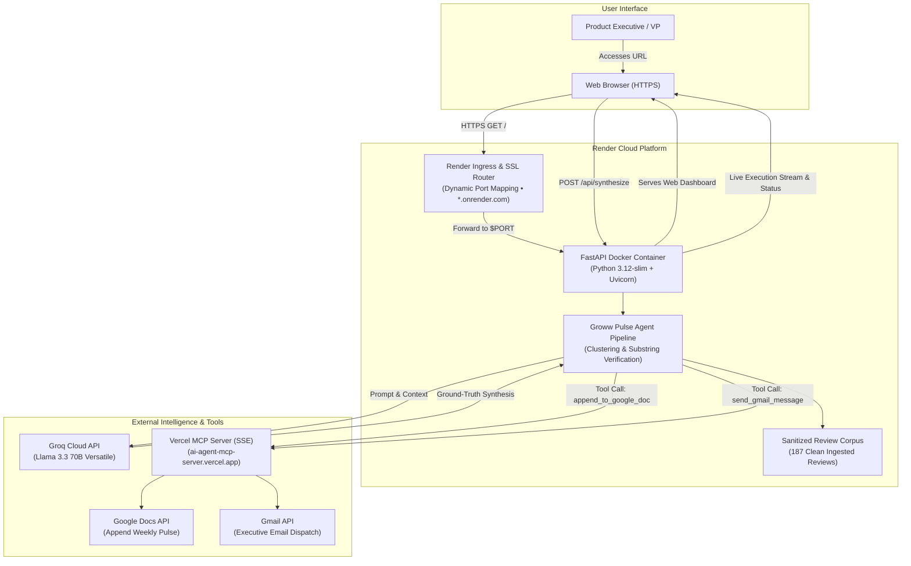

# Production Deployment Plan: Groww Feedback Pulse on Render

This document outlines the end-to-end production deployment strategy for hosting the **Groww Feedback Pulse Executive Dashboard & AI Agent** on [Render](https://render.com) using Render's generous **Free Tier Web Service**.

---

## 1. Executive Summary & Objective

The **Groww Feedback Pulse** application is a production-grade AI intelligence system that transforms unfiltered customer feedback from Google Play Store into executive weekly memos for Groww leadership. It features an interactive **FastAPI** web dashboard styled with Google Stitch ("Executive Emerald" design) and an autonomous **Groq Llama 3.3 70B** agent pipeline communicating with a remote **Vercel MCP Server** over Server-Sent Events (SSE) to update Google Docs and dispatch executive emails.

### Key Deployment Objectives:
- **Cloud Platform**: Render (Free Tier Web Service with continuous GitHub deployment).
- **Service Type**: Docker Web Service running FastAPI / Uvicorn.
- **Dynamic Port Binding**: Auto-configured by Render via `${PORT:-8501}` (Render injects `PORT=10000` by default).
- **Zero-Downtime Rolling Deploys**: Verified by automated healthchecks (`/health`).
- **Monthly Free Quota**: **750 free instance hours per month** (sufficient to run the service 24/7 all month without billing).
- **External Dependencies**:
  - Remote Vercel MCP Server: `https://ai-agent-mcp-server.vercel.app/sse`
  - Target Google Doc: `1chaQkkUovsVC7OGYM1HOSiPPFGW3bdcuOKSm6eLopSM`
  - Email Recipient: `nagesh14423@gmail.com`
  - Groq Cloud API: `llama-3.3-70b-versatile`

---

## 2. Cloud Architecture Flow



---

## 3. Containerization & Repository Assets

The project includes pre-configured deployment artifacts adhering strictly to production cloud container standards:

### 3.1 `Dockerfile`
- **Base Image**: `python:3.12-slim` for minimal container footprint (<150MB).
- **System Tools**: Installs `curl` for container-level healthchecks.
- **Port Exposure**: Dynamic `$PORT` binding via `sh -c "uvicorn src.web:app --host 0.0.0.0 --port ${PORT:-8501}"`.
- **Exposed Ports**: `8501` (local default) and `10000` (Render default).
- **Healthcheck**: 30-second interval testing `http://127.0.0.1:${PORT:-8501}/health`.

### 3.2 `render.yaml` (Infrastructure-as-Code Blueprint)
Declarative service specification enabling 1-click Render blueprint deployments:
```yaml
services:
  - type: web
    name: groww-feedback-pulse
    runtime: docker
    plan: free
    region: oregon
    healthCheckPath: /health
    autoDeploy: true
    envVars:
      - key: GROQ_API_KEY
        sync: false
      - key: MCP_AUTH_KEY
        value: nagesh
      - key: GOOGLE_DOC_ID
        value: 1chaQkkUovsVC7OGYM1HOSiPPFGW3bdcuOKSm6eLopSM
      - key: PULSE_EMAIL_RECIPIENT
        value: nagesh14423@gmail.com
      - key: MCP_SERVER_URL
        value: https://ai-agent-mcp-server.vercel.app/sse
      - key: MCP_HEALTH_URL
        value: https://ai-agent-mcp-server.vercel.app/health
      - key: SETTINGS_FILE
        value: config/settings.yaml
      - key: MCP_CONFIG_FILE
        value: config/mcp_config.json
```

### 3.3 `.dockerignore`
Prevents local virtual environments, `.git` histories, and sensitive `.env` files from leaking into the container:
```text
.git/
.venv/
venv/
__pycache__/
*.pyc
.pytest_cache/
tests/
.env
.env.local
```

---

## 4. Prerequisites

Before deploying to Render, ensure you have:
1. **GitHub Repository**: The code is pushed to [https://github.com/nagesh-labs/ai-agent-pulse-report-generation](https://github.com/nagesh-labs/ai-agent-pulse-report-generation).
2. **Render Account**: A free account at [render.com](https://render.com) (sign in using your GitHub account).
3. **Groq Cloud API Key**: Valid API key from [Groq Console](https://console.groq.com/keys) (`gsk_...`).
4. **Vercel MCP Auth Key**: Master bearer authentication token (`nagesh`).
5. **Google Workspace Identifiers**:
   - Target Google Doc ID: `1chaQkkUovsVC7OGYM1HOSiPPFGW3bdcuOKSm6eLopSM`
   - Executive Email Recipient: `nagesh14423@gmail.com`

---

## 5. Step-by-Step Render Deployment Guide

### Method A: Deploy via Render Web Dashboard (Recommended)

#### Step 1: Sign In & Connect GitHub
1. Open [dashboard.render.com](https://dashboard.render.com).
2. Sign in with your GitHub account (`nagesh-labs`).
3. Click the **+ New** button at the top-right $\to$ Select **Web Service**.

#### Step 2: Select Repository
1. In the list of repositories, find `ai-agent-pulse-report-generation`.
2. Click **Connect**.
   *(If the repository is not listed, click "Configure account" to grant Render access to your repo).*

#### Step 3: Configure Web Service Parameters
Fill in the basic settings:

| Field | Recommended Value |
| :--- | :--- |
| **Name** | `groww-feedback-pulse` |
| **Region** | `Oregon (US West)` or `Frankfurt (EU Central)` |
| **Branch** | `main` |
| **Root Directory** | *(Leave blank)* |
| **Runtime** | **Docker** *(Render detects the Dockerfile automatically)* |
| **Instance Type** | **Free** ($0 / month — 512 MB RAM, 0.1 CPU) |

#### Step 4: Configure Environment Variables
Under the **Environment Variables** section, click **Add Environment Variable** for each key:

| Key | Value | Purpose |
| :--- | :--- | :--- |
| `GROQ_API_KEY` | `gsk_...` | Groq Cloud API key for Llama 3.3 70B inference |
| `MCP_AUTH_KEY` | `nagesh` | Master authorization token for Vercel MCP Server |
| `GOOGLE_DOC_ID` | `1chaQkkUovsVC7OGYM1HOSiPPFGW3bdcuOKSm6eLopSM` | Target Google Doc ID for pulse reports |
| `PULSE_EMAIL_RECIPIENT` | `nagesh14423@gmail.com` | Target recipient email address |
| `MCP_SERVER_URL` | `https://ai-agent-mcp-server.vercel.app/sse` | MCP Server SSE endpoint |
| `MCP_HEALTH_URL` | `https://ai-agent-mcp-server.vercel.app/health` | MCP Server healthcheck endpoint |
| `SETTINGS_FILE` | `config/settings.yaml` | Application configuration profile |
| `MCP_CONFIG_FILE` | `config/mcp_config.json` | MCP client tool configuration |

*(Note: Do **NOT** manually set `PORT`. Render automatically assigns `PORT=10000` to the container).*

#### Step 5: Configure Health Check Path
1. Click **Advanced** at the bottom of the form.
2. In the **Health Check Path** input, type: `/health`.
3. Auto-Deploy: Set to **Yes** (Render will redeploy whenever you push to `main`).

#### Step 6: Create Web Service
1. Click the purple **Create Web Service** button.
2. Render will begin building the Docker image, installing dependencies, and spinning up the container.
3. Once the build completes and the `/health` endpoint returns `200 OK`, Render will mark the service **Live**.
4. Your application will be live at a public HTTPS URL (e.g., `https://groww-feedback-pulse.onrender.com`).

---

### Method B: Deploy via Render Blueprint (`render.yaml`)

Because the repository includes `render.yaml`, you can also deploy using Render's Blueprint engine:
1. Go to [dashboard.render.com/blueprints](https://dashboard.render.com/blueprints).
2. Click **New Blueprint Instance**.
3. Connect `nagesh-labs/ai-agent-pulse-report-generation`.
4. Render will read `render.yaml` and pre-populate the service configuration and all environment variables.
5. Enter your `GROQ_API_KEY` secret when prompted.
6. Click **Apply**.

---

## 6. Comprehensive Environment Variables Reference

| Variable | Type | Default / Recommended | Mandatory? | Description & Failure Mode |
| :--- | :--- | :--- | :--- | :--- |
| `GROQ_API_KEY` | Secret | `gsk_...` | **Yes** | Authenticates LLM calls for semantic clustering and note distillation. If missing, agent returns 401 Unauthorized. |
| `MCP_AUTH_KEY` | Secret | `nagesh` | **Yes** | Master bearer key for Vercel MCP server. If missing or invalid, MCP tool calls return 401 Unauthorized. |
| `GOOGLE_DOC_ID` | String | `1chaQkkUovsVC7OGYM1HOSiPPFGW3bdcuOKSm6eLopSM` | **Yes** | Target Google Doc identifier. If invalid, `append_to_google_doc` fails with 404 / 403. |
| `PULSE_EMAIL_RECIPIENT` | String | `nagesh14423@gmail.com` | **Yes** | Target leadership email. If omitted, defaults to internal config fallback. |
| `MCP_SERVER_URL` | URL | `https://ai-agent-mcp-server.vercel.app/sse` | **Yes** | SSE transport URL. If unreachable, delivery tools fallback to offline logging. |
| `MCP_HEALTH_URL` | URL | `https://ai-agent-mcp-server.vercel.app/health` | Optional | Healthcheck URL polled by web UI to display `MCP Online` status badge. |
| `PORT` | Integer | Assigned by Render (10000) | Auto | Injected dynamically by Render. `Dockerfile` uses `${PORT:-8501}`. |
| `SETTINGS_FILE` | Path | `config/settings.yaml` | Optional | Path to local settings YAML file. |
| `MCP_CONFIG_FILE` | Path | `config/mcp_config.json` | Optional | Path to MCP tool schema configuration. |

---

## 7. Healthchecks, Cold-Starts & Free-Tier Optimization

Render Free Tier provides **750 free instance hours per month** (enough to run 1 service continuously 24/7). Understanding its behavior ensures smooth operation:

1. **Inactivity Sleep (Spindown)**:
   - Render spins down free web services after **15 minutes** of no incoming web requests.
   - When a user visits the URL, Render automatically wakes the container up.
   - **Cold Start Time**: Because our container is slim and dataset is local (<150KB), cold wake-up takes only **~15–25 seconds**.
2. **Automated Healthchecks**:
   - Render polls `GET /health` during deployment.
   - Only when `/health` returns HTTP 200 `{"status": "healthy", ...}` does Render switch traffic to the new container, guaranteeing zero-downtime deploys.
3. **Preventing Inactivity Sleep (Optional)**:
   - If you want the service to stay warm 24/7, you can use a free uptime monitor (such as [UptimeRobot](https://uptimerobot.com) or [Cron-job.org](https://cron-job.org)) to ping `https://<your-service>.onrender.com/health` once every 10 minutes.

---

## 8. Post-Deployment Verification & Smoke Tests

After Render marks the service **Live**, execute this verification protocol:

### Step 1: Healthcheck Test via cURL
Run in terminal:
```powershell
curl -i https://<YOUR_RENDER_SUBDOMAIN>.onrender.com/health
```
**Expected Output**:
```http
HTTP/2 200
content-type: application/json

{"status":"healthy","service":"groww-feedback-pulse","version":"2.8.4"}
```

### Step 2: Web Dashboard UI Verification
1. Open `https://<YOUR_RENDER_SUBDOMAIN>.onrender.com` in your browser.
2. Confirm the **Header** renders cleanly with the `MCP Online` green status pill and Google Doc direct link.
3. Confirm the **4 Context Tiles** display:
   - Total Reviews Ingested: `187`
   - Critical Friction (1-2★): `48.7%`
   - Positive Praise (5★): `35.8%`
   - Word Limit: `250 words`
4. Confirm the **Dropdown** offers:
   - `Past 1 Week` (132 reviews, Oct 24, 2026 – Oct 31, 2026)
   - `Past 2 Weeks` (187 reviews, Oct 21, 2026 – Oct 31, 2026)

### Step 3: End-to-End Live Pulse Generation Test
1. Select `Past 1 Week` in the dropdown.
2. Click the primary button: **"Generate & Send Pulse Report"**.
3. Observe live execution status:
   - Button changes to *"Synthesizing pulse report..."*
   - Execution status updates with live timestamps.
4. Verify results within 10–15 seconds:
   - Green delivery confirmation banner appears:
     - `Google Doc: Appended ✅`
     - `Email: Sent ✅`
   - Executive Pulse note renders formatted markdown with Top 3 Friction Themes and verbatim quotes.
5. Inspect the Google Doc:
   - Open [Target Google Doc](https://docs.google.com/document/d/1chaQkkUovsVC7OGYM1HOSiPPFGW3bdcuOKSm6eLopSM/edit).
   - Confirm the new weekly pulse entry has been appended with the correct timestamp and date range.
6. Inspect Leadership Email:
   - Confirm receipt of executive email at `nagesh14423@gmail.com`.

---

## 9. Troubleshooting & Operations

### Issue 1: "Timed out waiting for port 10000 to be open"
- **Symptom**: Render build logs show `==> Port scan timeout reached`.
- **Root Cause**: The application bound to `127.0.0.1` instead of `0.0.0.0`, or hardcoded port `8501` instead of using Render's `$PORT`.
- **Solution**: Confirm `Dockerfile` uses `uvicorn src.web:app --host 0.0.0.0 --port ${PORT:-8501}`. This is pre-configured and verified.

### Issue 2: Dashboard initial load takes 25 seconds
- **Symptom**: First load after inactivity takes ~20–30s.
- **Root Cause**: Expected behavior on Render Free Tier when the container wakes up from sleep. Subsequent clicks are instantaneous.
- **Solution**: Optional free ping every 10 minutes via UptimeRobot to `/health`.

### Issue 3: MCP Tool Delivery indicates "Error" or "Offline"
- **Symptom**: Dashboard displays `MCP Offline` or delivery returns status `failed`.
- **Root Cause**: `MCP_AUTH_KEY` is missing or mismatched in Render Environment Variables.
- **Solution**: Go to Render Dashboard $\to$ **Environment** $\to$ Verify `MCP_AUTH_KEY` is set to `nagesh` and `MCP_SERVER_URL` is `https://ai-agent-mcp-server.vercel.app/sse`.

### Issue 4: Google Doc Append fails (HTTP 401/403)
- **Symptom**: MCP server returns OAuth authentication error for Google Docs.
- **Root Cause**: The Google OAuth refresh token on the Vercel MCP server may need re-authorization.
- **Solution**: Access the Vercel MCP Server administrative console or trigger the Google OAuth re-consent flow to refresh credentials.

---

## 10. Continuous Deployment & Rollback Strategy

Render provides automated continuous deployment and instant rollback capabilities:
1. **Continuous Deployment**: Every push to the `main` branch on GitHub automatically triggers a zero-downtime rolling build on Render.
2. **Instant Rollback**: If a deployment encounters issues, navigate to your service in the Render Dashboard $\to$ **Events** tab $\to$ locate the previous successful deploy $\to$ click **Rollback to this deploy**. Render will immediately route traffic back to the previous stable container image.
