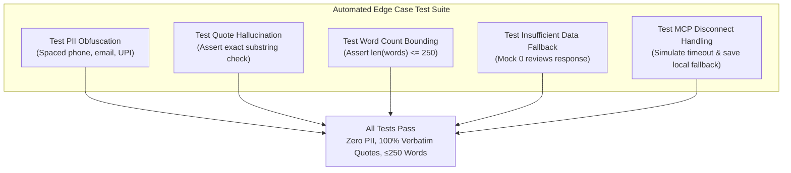

# Edge Cases & Corner Scenarios: Mobile App Feedback Pulse (Groww)

## 1. Overview

This document provides a comprehensive analysis of boundary conditions, edge cases, failure modes, and corner scenarios across the entire lifecycle of the **Groww Mobile App Feedback Pulse** agent system.

Each edge case is categorized by pipeline subsystem, detailing the potential failure impact, programmatic mitigation strategy, and test validation approach.

---

## 2. Subsystem Edge Case Matrix

| ID | Subsystem | Category | Severity | Description |
| :--- | :--- | :--- | :--- | :--- |
| **EC-01** | Ingestion | Data Volume | High | Insufficient / Zero reviews within the 8–12 week window. |
| **EC-02** | Ingestion | Data Volume | High | Massive review surge (>10,000 reviews) during market volatility. |
| **EC-03** | Ingestion | Network / Rate Limits | Medium | Google Play Store 429 Too Many Requests / IP throttling. |
| **EC-04** | Ingestion | Data Quality | Medium | Spam, emoji-only, single-word, or gibberish reviews. |
| **EC-05** | Ingestion | Language & Scripts | High | Multilingual, Indic scripts (Hindi, Tamil), or Hinglish text. |
| **EC-06** | Ingestion | Timezone & Date Skew | Low | Reviews with future timestamps or mismatched timezones (IST vs UTC). |
| **EC-07** | Privacy | PII Redaction | Critical | Obfuscated phone numbers, spaced emails, or spelled-out digits. |
| **EC-08** | Privacy | PII Redaction | High | Financial identifiers (UPI VPAs, Demat Folio IDs, PANs, bank accounts). |
| **EC-09** | Privacy | Over-Sanitization | Medium | Legitimate numerical data (e.g., "lost Rs. 50,000") falsely masked as PII. |
| **EC-10** | Processing | Thematic Clustering | Medium | Monolithic sentiment (e.g., 95% of reviews about one server crash). |
| **EC-11** | Processing | Sentiment Inversion | Medium | 5-star rating with scathing text, or 1-star rating with praise. |
| **EC-12** | Processing | Quote Hallucination | Critical | LLM modifies, fixes grammar, or paraphrases real user quotes. |
| **EC-13** | Processing | Quote Usability | Medium | LLM selects quotes that are either too long (>100 words) or too vague ("bad"). |
| **EC-14** | Processing | Word Count Constraint | High | Synthesized note exceeds strict 250-word ceiling. |
| **EC-15** | MCP Layer | Server Availability | High | Google Docs or Gmail MCP server process crash or stdio disconnect. |
| **EC-16** | MCP Layer | Auth Expiration | High | MCP server credentials / session expired mid-pipeline execution. |
| **EC-17** | MCP Layer | Idempotency | Medium | Duplicate script execution creates redundant Docs and Gmail drafts. |
| **EC-18** | Runtime | OS & Encoding | Low | Windows console UTF-8 vs CP1252 encoding breaks with emojis. |

---

## 3. Detailed Subsystem Analysis & Mitigations

### 3.1 Data Ingestion & Scraper Edge Cases

#### EC-01: Insufficient / Zero Reviews in Date Range
- **Scenario**: A network filter error or store anomaly yields fewer than 10 reviews in the 8–12 week window.
- **Failure Impact**: The clustering engine fails or hallucinates themes due to lack of statistical signal.
- **Mitigation**:
  - Implement a threshold guardrail in `ReviewFetcher`:
    $$\text{count}(\text{reviews}) \ge \text{MIN\_REVIEWS\_THRESHOLD} \quad (\text{default: } 50)$$
  - If review count is below threshold, automatically expand lookback window incrementally (e.g., from 8 to 16 weeks) or raise a structured `InsufficientDataError` with diagnostic logs.
- **Testing**: Mock scraper returning 0 and 5 reviews; assert graceful fallback and exception messaging.

#### EC-02: Extreme Review Surge (>10,000 Reviews)
- **Scenario**: During market events or major outages, review volume spikes significantly.
- **Failure Impact**: Memory exhaustion during ingestion, LLM context window overflow, or massive LLM billing costs.
- **Mitigation**:
  - Implement **Stratified Batch Sampling**: Cap maximum reviews ingested for LLM analysis at $N=1,500$.
  - Sample proportionately across rating tiers (e.g., 60% negative ratings 1–2★, 20% neutral 3★, 20% positive 4–5★) and thumbs-up vote counts (high engagement reviews weighted higher).

```python
def stratified_sample(reviews: list[ReviewRecord], max_sample: int = 1500) -> list[ReviewRecord]:
    if len(reviews) <= max_sample:
        return reviews
    # Prioritize reviews with high helpfulness/thumbs-up and low ratings (friction focus)
    sorted_reviews = sorted(reviews, key=lambda r: (r.rating <= 2, r.thumbs_up_count), reverse=True)
    return sorted_reviews[:max_sample]
```

#### EC-03: Google Play Scraper Rate Limiting (HTTP 429)
- **Scenario**: Repeated requests trigger Google Play throttling.
- **Failure Impact**: Incomplete pagination and pipeline termination.
- **Mitigation**:
  - Implement exponential backoff with jitter (initial delay: 1.5s, max delay: 10s, factor: 2.0).
  - Cache intermediate batches to disk (`data/raw/batch_*.json`) so resuming does not re-fetch existing data.

#### EC-04: Spam, Emoji-Only, or Meaningless Reviews
- **Scenario**: Reviews containing only emojis (e.g., "👍👍👍"), single characters ("k"), or repeated spam ("groww groww groww").
- **Failure Impact**: Dilutes clustering quality and wastes prompt tokens.
- **Mitigation**:
  - Apply heuristic text hygiene filters prior to sanitization:
    - Minimum word count $\ge 3$ words.
    - Minimum alphabetic character ratio $\ge 40\%$ (eliminates pure emoji/punctuation strings).
    - Deduplication: Filter out identical repeated review bodies within the same batch.

#### EC-05: Multilingual, Indic Scripts & Hinglish Feedback
- **Scenario**: Indian retail trading users frequently review in Hinglish ("paisa kat gaya account se but balance zero"), Devanagari Hindi ("पैसे कट गए लेकिन वॉलेट में नहीं आए"), or regional scripts.
- **Failure Impact**: English-only tokenizers or models may fail to cluster correctly or mistranslate nuances.
- **Mitigation**:
  - Use high-performance LLM models (e.g. Groq Llama 3.3 70B) with comprehensive language comprehension.
  - The system prompt explicitly instructs the LLM to understand Hinglish and Indic scripts, while synthesizing the executive output in professional English.
  - Verbatim quotes preserved in their original script/form to ensure zero distortion of user voice.

---

### 3.2 Privacy & PII Sanitization Edge Cases

#### EC-07: Obfuscated or Spaced PII Patterns
- **Scenario**: Users write: `call me on 9 8 7 6 5 4 3 2 1 0` or `my email is rahul [dot] verma at gmail`.
- **Failure Impact**: Standard regex misses obfuscated PII, leaking identifiable data into Google Docs.
- **Mitigation**:
  - Multi-pass regex normalizer:
    1. Pass 1: Collapse single-space sequences between consecutive digits: `"9 8 7 6 5"` $\to$ `"98765"`.
    2. Pass 2: Detect written obfuscations: `\s*\[dot\]\s*` $\to$ `.`, `\s*\[at\]\s*` $\to$ `@`.
    3. Pass 3: Standard E.164 and Indian mobile phone regex matching.

```python
OBFUSCATED_DIGIT_PATTERN = re.compile(r'(?<=\b\d)\s+(?=\d\b)')
EMAIL_PATTERN = re.compile(r'[\w\.-]+@[\w\.-]+\.\w+')
PHONE_PATTERN = re.compile(r'(?:\+?91[\-\s]?)?[6-9]\d{9}')

def scrub_pii(text: str) -> str:
    # Normalize spaced digits
    collapsed = OBFUSCATED_DIGIT_PATTERN.sub('', text)
    # Mask emails & phones
    sanitized = EMAIL_PATTERN.sub('[REDACTED_EMAIL]', collapsed)
    sanitized = PHONE_PATTERN.sub('[REDACTED_PHONE]', sanitized)
    return sanitized
```

#### EC-08: Financial & Regulatory Identifiers (UPI, PAN, Folio)
- **Scenario**: Reviewers paste actual UPI IDs (`9876543210@paytm`), PAN numbers (`ABCDE1234F`), or 16-digit Demat Account / DP IDs in dispute complaints.
- **Failure Impact**: Severe regulatory violation (SEBI/RBI data protection violation).
- **Mitigation**:
  - Specific regex masks for Indian fintech identifiers:
    - UPI VPA: `[\w\.\-]+@(okaxis|okhdfcbank|okicici|paytm|ybl|apl|upi)`
    - PAN Number: `[A-Z]{5}[0-9]{4}[A-Z]{1}`
    - 16-digit Demat / Folio numbers: `\b\d{16}\b` or `\bIN\d{14}\b`

#### EC-09: False Positive Numerical Redaction
- **Scenario**: User complains: "Lost 45000 in option trading" or "Order 500 error".
- **Failure Impact**: If "45000" or "500" gets replaced by `[REDACTED_PHONE]`, context becomes corrupted.
- **Mitigation**:
  - Bound phone number checks to strict Indian mobile prefix rules ($[6-9]\d{9}$) and 10 digits; do not match 3–6 digit currency/error values.

---

### 3.3 Agentic Processing & LLM Edge Cases

#### EC-10: Monolithic Sentiment (Single Dominant Theme)
- **Scenario**: A major outage occurs during budget day; 95% of reviews complain about server downtime.
- **Failure Impact**: Forcing 5 distinct themes results in redundant or superficial micro-themes.
- **Mitigation**:
  - The requirement specifies: **at most 5 themes** (upper bound, not a forced minimum).
  - If the dataset naturally has only 2 or 3 distinct clusters, the agent returns 2–3 themes without fabricating artificial categories.

#### EC-11: Sentiment & Star-Rating Inversion
- **Scenario**: Reviewer gives 5 stars with text: "Extremely worst app ever, funds deducted but not credited." (Sarcasm or mistaken rating).
- **Failure Impact**: Relying solely on star ratings categorizes negative complaints as praise.
- **Mitigation**:
  - Theme clustering relies on **semantic review text embeddings and LLM content analysis**, not numerical star ratings alone. Star rating is treated as secondary metadata.

#### EC-12: Quote Hallucination or Grammar Correction
- **Scenario**: User wrote: `"app hang when I buyed call option"`. The LLM attempts to output: `"App hangs when I bought call option"`.
- **Failure Impact**: Violates the non-negotiable constraint: *"verbatim snippets from reviews, no invented wording"*.
- **Mitigation**:
  - **Deterministic Substring Assertion**:
    ```python
    def validate_verbatim_quote(quote: str, corpus: list[str]) -> bool:
        clean_quote = " ".join(quote.strip().split())
        for raw_text in corpus:
            clean_raw = " ".join(raw_text.strip().split())
            if clean_quote in clean_raw:
                return True
        return False
    ```
  - If the LLM generates a quote that fails this assertion:
    1. Reject the output.
    2. Search the designated review ID and slice the longest contiguous matching sentence.
    3. Replace the candidate quote with the exact text slice.

#### EC-13: Quotes Exceedingly Long or Meaningless
- **Scenario**: LLM selects a 120-word rambling review, which consumes half of the total allowable pulse note length.
- **Failure Impact**: Blows the $\le$ 250-word note limit or degrades scannability.
- **Mitigation**:
  - Prompt constraint: Instruct quote selection between **15 and 35 words**.
  - Programmatic length guardrail: If selected quote $> 40$ words, truncate to the first complete sentence of that quote that remains verbatim.

#### EC-14: Pulse Note Word Count Ceiling Overflow (>250 Words)
- **Scenario**: The distilled weekly pulse note reaches 285 words.
- **Failure Impact**: Violates stakeholder scannability constraint ($\le 250$ words).
- **Mitigation**:
  - **Deterministic Post-Processor**:
    ```python
    def enforce_word_limit(note_markdown: str, max_words: int = 250) -> str:
        words = note_markdown.split()
        if len(words) <= max_words:
            return note_markdown
        # If overflowing, execute bounded compression prompt preserving exact quotes
        return recompress_note(note_markdown, max_words=max_words)
    ```

---

### 3.4 Model Context Protocol (MCP) Integration Edge Cases

#### EC-15: MCP Server Disconnection / Process Crash
- **Scenario**: The local Google Docs or Gmail MCP server process terminates or closes stdio pipes.
- **Failure Impact**: The agent hangs or crashes before delivering artifacts.
- **Mitigation**:
  - Implement a 15-second heartbeat and timeout on all MCP tool calls.
  - Implement an auto-restart retry policy (max 2 retries).
  - If MCP remains unreachable, serialize the final synthesized note to `data/processed/pending_pulse_<date>.md` so no analysis work is lost.

#### EC-16: OAuth Session / Credential Expiry in MCP
- **Scenario**: The Google Docs or Gmail authentication token expires on the host machine.
- **Failure Impact**: MCP tool returns error code `UNAUTHENTICATED` or `PERMISSION_DENIED`.
- **Mitigation**:
  - Capture specific MCP error payload.
  - Emit an actionable error notification prompting the user:
    > `[MCP Auth Error]: Google Docs / Gmail MCP server reported expired credentials. Please re-authenticate via your MCP runtime.`
  - Prevent script crash; dump markdown artifact locally.

#### EC-17: Duplicate Execution / Idempotency Failure
- **Scenario**: The automated cron job triggers twice within 10 minutes.
- **Failure Impact**: Generates duplicate Google Docs and floods Gmail drafts.
- **Mitigation**:
  - Implement a weekly execution lockfile: `data/.pulse_lock_<YYYY_WW>`.
  - Check whether a doc for the current ISO week already exists before creating a new one; if so, update the existing document instead of spawning duplicates.

---

### 3.5 Runtime & Environment Edge Cases

#### EC-18: Windows Console Encoding & Character Sets
- **Scenario**: Reviews containing special currency symbols (`₹`), emojis, or Hindi characters printed to Windows PowerShell with `CP1252` encoding.
- **Failure Impact**: `UnicodeEncodeError: 'charmap' codec can't encode characters`.
- **Mitigation**:
  - Ensure all file operations explicitly specify `encoding="utf-8"`.
  - Set Python standard output encoding in entrypoint:
    ```python
    import sys
    if sys.platform == "win32":
        sys.stdout.reconfigure(encoding='utf-8')
    ```

---

## 4. Edge Case Test Matrix & Guardrail Verifications



| Edge Case Test | Test File | Target Assertion |
| :--- | :--- | :--- |
| **Obfuscated PII Redaction** | `tests/test_pii_sanitizer.py` | `assert "[REDACTED" in sanitized and not re.search(r'\d{10}', sanitized)` |
| **Zero Quote Hallucination** | `tests/test_quote_verifier.py` | `assert quote in original_review_corpus` |
| **Strict Word Limit** | `tests/test_pulse_distiller.py` | `assert len(note.split()) <= 250` |
| **Theme Limit Bound** | `tests/test_clusterer.py` | `assert 1 <= len(themes) <= 5` |
| **MCP Failure Fallback** | `tests/test_mcp_integration.py` | `assert os.path.exists("data/processed/pending_pulse.md")` |

