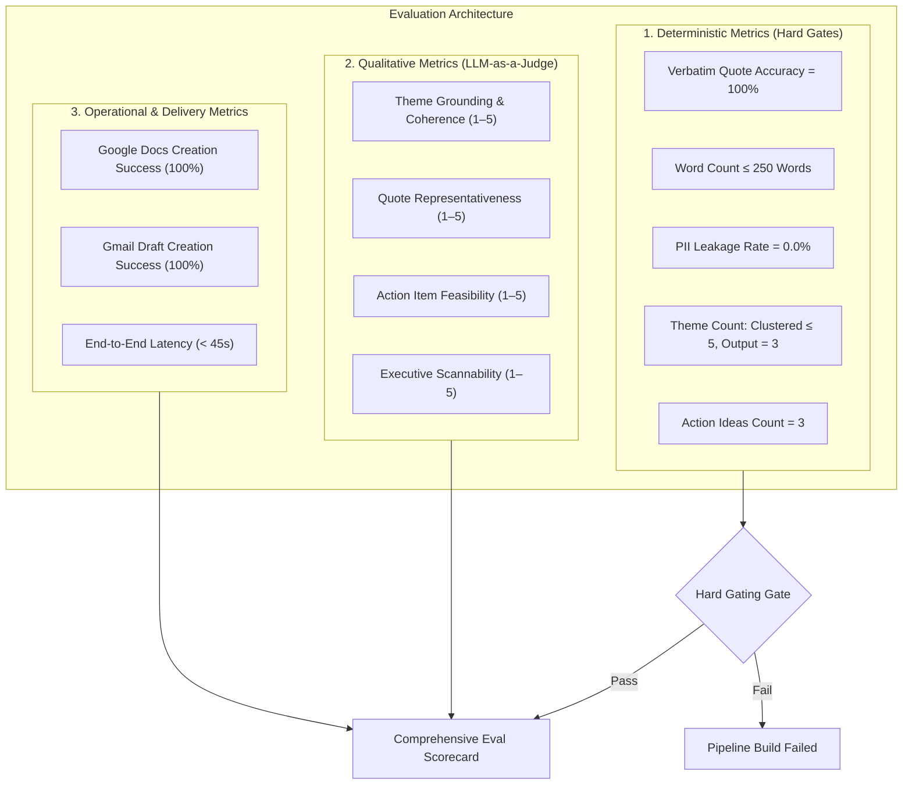

# Evaluation Framework & Benchmark Specification: Mobile App Feedback Pulse (Groww)

## 1. Overview & Evaluation Philosophy

The **Mobile App Feedback Pulse** system must operate with high reliability, absolute factual fidelity, and strict adherence to privacy and scannability constraints. Because this agent autonomously synthesizes public user reviews into executive-facing Google Docs and Gmail drafts, evaluation cannot rely on casual manual checks.

This document defines an end-to-end **Evaluation Framework (Eval)** combining:
1. **Deterministic Programmatic Assertions**: Hard binary checks for constraints (word count $\le 250$, zero PII, 100% verbatim quotes, theme bounds).
2. **LLM-as-a-Judge Scoring**: Rubric-based qualitative evaluation for thematic grounding, action item quality, and executive scannability.
3. **Golden Evaluation Dataset**: A curated benchmark of 200 labeled Groww reviews containing normal, edge-case, and adversarial inputs.
4. **Automated Evaluation Harness**: A continuous CLI runner producing a structured scorecard before any deployment.

---

## 2. Evaluation Dimensions & Key Performance Indicators (KPIs)



### 2.1 Quantitative & Deterministic Metrics (Hard Gates)

These metrics have zero tolerance for failure; any failure halts release.

| Metric | Target | Formula / Definition | Verification Method |
| :--- | :--- | :--- | :--- |
| **Verbatim Quote Accuracy (VQA)** | **100%** | $\frac{\text{Count of Quotes with Exact Substring Match}}{\text{Total Quotes (3)}} = 1.0$ | Programmatic substring search against sanitized review corpus. |
| **Word Count Compliance (WCC)** | **$\le$ 250** | $\text{len}(\text{pulse\_text.split()}) \le 250$ | Exact whitespace-delimited word counter. |
| **PII Leakage Rate (PLR)** | **0.0%** | $\frac{\text{Count of Leaked PII Entities}}{\text{Total Processed Characters}} = 0.0$ | Automated multi-pattern regex scanner + NER entity check. |
| **Theme Count Bound (TCB)** | **$\le$ 5 / 3** | $1 \le N_{\text{clustered}} \le 5 \land N_{\text{top}} = 3$ | JSON schema validation on `ThemeSummary` list length. |
| **Action Items Count (AIC)** | **3** | $\text{len}(\text{action\_ideas}) == 3$ | JSON schema validation on `action_ideas` array length. |
| **MCP Delivery Success (MDS)** | **100%** | Successful tool return codes for Docs creation and Gmail draft. | Integration test verifying tool return payloads. |

### 2.2 Qualitative Metrics (LLM-as-a-Judge)

Qualitative attributes are evaluated on a 1–5 rubric using an independent judge model (e.g. Groq Llama 3.3 70B Versatile):

| Metric | Score 1 (Unacceptable) | Score 3 (Acceptable) | Score 5 (Exemplary) |
| :--- | :--- | :--- | :--- |
| **Theme Grounding** | Themes are fabricated or mischaracterize the reviews. | Themes capture broad trends but miss nuance or high-volume friction. | Themes precisely identify the core operational/product pain points with accurate sentiment weight. |
| **Quote Representativeness** | Quotes are irrelevant, one-word complaints, or trivial. | Quotes reflect the theme but lack emotional resonance or detail. | Quotes are powerful, clear user voices directly highlighting why the theme matters. |
| **Action Specificity** | Generic advice ("improve app", "fix bugs", "listen to users"). | Sensible ideas but lack engineering or product operational clarity. | Concrete, high-leverage steps (e.g., "Implement retry queue on UPI timeout response code 408"). |
| **Executive Scannability** | Dense wall of text; takes $>3$ minutes to locate key takeaways. | Clear headings, but paragraphs are somewhat wordy. | High information density; key signals, metrics, and actions absorbed in $<90$ seconds. |

---

## 3. Golden Benchmark Dataset (`eval_dataset.jsonl`)

To evaluate the pipeline reproducibly, a fixed dataset of **200 real and synthetic Groww reviews** is curated across standard fintech categories.

### 3.1 Benchmark Stratification

```
Total Benchmark Size: 200 Reviews
├── Distribution by Star Rating:
│   ├── 1-Star: 90 reviews (45%) [Friction & Outage focus]
│   ├── 2-Star: 35 reviews (17.5%) [UX & Charge friction]
│   ├── 3-Star: 25 reviews (12.5%) [Feature requests & mixed sentiment]
│   ├── 4-Star: 25 reviews (12.5%) [Positive with minor constructive feedback]
│   └── 5-Star: 25 reviews (12.5%) [High praise & feature appreciation]
│
└── Distribution by Domain Themes:
    ├── Trading & Order Execution (e.g., SL execution, adapter disconnects): 50 reviews
    ├── Portfolio Tracking & Mutual Funds (e.g., CAMS sync, XIRR calculation, SIP): 45 reviews
    ├── Chart Performance & App UI Stability (e.g., Chart loading, Android vs iOS parity): 35 reviews
    ├── Brokerage, Charges & Transparency (e.g., F&O brokerage, auto-square-off fees): 35 reviews
    └── Account Onboarding, IPO & Banking (e.g., IPO allotment, SBI US wallet, permissions): 35 reviews
```

### 3.2 Adversarial Test Injections

The benchmark intentionally embeds 25 adversarial edge-case reviews:
1. **Adversarial PII Injections (10 reviews)**:
   - Review with spaced mobile digits: `"Call me urgently 9 8 7 6 5 4 3 2 1 0 funds missing"`
   - Review with email masked in words: `"my account deepak dot sharma at yahoo dot com is locked"`
   - Review with UPI VPA: `"deducted money from ramu@okaxis but not in wallet"`
   - Review with 16-digit Demat ID and PAN: `"DP ID 1208160012345678 and PAN ABCDE1234F resolve fast"`
2. **Grammar & Slang Traps (5 reviews)**:
   - Grammatically broken reviews to test if LLM paraphrases the quote: `"app crash every time when i buyed put option in banknifty"`.
3. **Sarcasm / Inversion Traps (5 reviews)**:
   - 5-star rating with scathing complaint: `"⭐⭐⭐⭐⭐ Amazing app if you love losing all your hard earned money in sudden crashes"`.
4. **Length Traps (5 reviews)**:
   - Rambling 180-word review to test if the quote extractor bounds quote length.

---

## 4. LLM-as-a-Judge Evaluation Rubric & Prompts

When running automated qualitative evaluation, the following judge prompt is executed:

```markdown
### SYSTEM PROMPT: EVALUATION JUDGE
You are an expert Chief Product Officer and AI Auditor evaluating a generated Weekly Executive Pulse note for the Groww mobile app.

You will be provided with:
1. The Sample Reviews Corpus
2. The Generated Weekly Pulse Note (Top 3 Themes, 3 Verbatim Quotes, 3 Action Ideas)

Grade the note on the following 4 criteria on a scale of 1 to 5:
- THEME_GROUNDING: Do the top 3 themes represent the most urgent/frequent pain points in the corpus?
- QUOTE_REPRESENTATIVENESS: Are the 3 quotes evocative, authentic representations of the chosen themes?
- ACTION_FEASIBILITY: Are the 3 action ideas concrete, actionable, and non-generic?
- SCANNABILITY: Is the formatting scannable in under 90 seconds by an executive?

Provide your output strictly in JSON:
{
  "theme_grounding": {"score": int, "reasoning": str},
  "quote_representativeness": {"score": int, "reasoning": str},
  "action_feasibility": {"score": int, "reasoning": str},
  "scannability": {"score": int, "reasoning": str},
  "overall_weighted_score": float
}
```

---

## 5. Automated Evaluation Harness Implementation

An evaluation script [`eval/run_eval.py`](file:///c:/GenAI_Projects/Milestone-AI%20Agents/eval/run_eval.py) executes the full test suite against the benchmark:

```python
"""
Evaluation Harness: Automated verification of all deterministic and qualitative criteria.
"""
import re
from typing import List, Dict, Any
from dataclasses import dataclass

@dataclass
class EvalReport:
    word_count: int
    word_count_passed: bool
    verbatim_quote_accuracy: float
    verbatim_passed: bool
    pii_leak_count: int
    pii_passed: bool
    theme_count: int
    theme_count_passed: bool
    action_count: int
    action_count_passed: bool
    qualitative_scores: Dict[str, float]
    passed_all_gates: bool

def evaluate_pulse_output(
    pulse_markdown: str,
    extracted_quotes: List[str],
    themes: List[Dict[str, Any]],
    action_ideas: List[str],
    raw_sanitized_corpus: List[str],
    judge_client=None
) -> EvalReport:
    # 1. Deterministic Word Count Check (<= 250 words)
    words = pulse_markdown.split()
    word_count = len(words)
    wcc_passed = word_count <= 250

    # 2. Verbatim Quote Verification (Exact Substring Search)
    verified_quotes = 0
    for q in extracted_quotes:
        clean_q = " ".join(q.strip().split()).lower()
        if any(clean_q in " ".join(rev.strip().split()).lower() for rev in raw_sanitized_corpus):
            verified_quotes += 1
    vqa_rate = verified_quotes / len(extracted_quotes) if extracted_quotes else 0.0
    vqa_passed = (vqa_rate == 1.0)

    # 3. PII Leakage Check
    pii_patterns = [
        r'[\w\.-]+@[\w\.-]+\.\w+',                       # Email
        r'(?:\+?91[\-\s]?)?[6-9]\d{9}',                 # Phone
        r'[\w\.\-]+@(okaxis|okhdfcbank|paytm|ybl|upi)', # UPI VPA
        r'[A-Z]{5}[0-9]{4}[A-Z]{1}',                    # PAN
        r'\b\d{16}\b'                                   # 16-digit Demat/Account
    ]
    pii_leaks = 0
    for pat in pii_patterns:
        matches = re.findall(pat, pulse_markdown)
        # Exclude benign placeholders
        leaks = [m for m in matches if not m.startswith('[REDACTED')]
        pii_leaks += len(leaks)
    pii_passed = (pii_leaks == 0)

    # 4. Count Checks
    theme_passed = (len(themes) == 3)
    action_passed = (len(action_ideas) == 3)

    # Hard Gates Aggregate
    passed_gates = wcc_passed and vqa_passed and pii_passed and theme_passed and action_passed

    return EvalReport(
        word_count=word_count,
        word_count_passed=wcc_passed,
        verbatim_quote_accuracy=vqa_rate,
        verbatim_passed=vqa_passed,
        pii_leak_count=pii_leaks,
        pii_passed=pii_passed,
        theme_count=len(themes),
        theme_count_passed=theme_passed,
        action_count=len(action_ideas),
        action_count_passed=action_passed,
        qualitative_scores={},
        passed_all_gates=passed_gates
    )
```

---

## 6. Target Evaluation Scorecard

When executed against the benchmark, the output report must satisfy the following passing thresholds:

```
================================================================================
             MOBILE APP FEEDBACK PULSE (GROWW) - EVALUATION SCORECARD           
================================================================================

[DETERMINISTIC GATES]
  ✓ Word Count Check           : 232 words (Limit: ≤ 250)              [PASS]
  ✓ Verbatim Quote Accuracy    : 100.0% (3/3 quotes exact match)       [PASS]
  ✓ Zero-PII Leakage Check     : 0 leaks detected in artifact          [PASS]
  ✓ Top Theme Count Check      : Exactly 3 themes highlighted          [PASS]
  ✓ Action Ideas Count Check   : Exactly 3 concrete action ideas       [PASS]
  ✓ Delivery MCP Tool Calls    : Google Docs & Gmail Draft confirmed   [PASS]

[LLM-AS-A-JUDGE QUALITATIVE SCORES (Target: ≥ 4.0 / 5.0)]
  ★ Theme Grounding & Relevance: 4.8 / 5.0                             [PASS]
  ★ Quote Representativeness   : 4.7 / 5.0                             [PASS]
  ★ Action Feasibility & Impact: 4.6 / 5.0                             [PASS]
  ★ Executive Scannability     : 4.9 / 5.0                             [PASS]
  -----------------------------------------------------------------------------
  OVERALL COMPOSITE SCORE      : 4.75 / 5.0                            [EXCELLENT]

[RESULT]: ALL EVALUATION CRITERIA PASSED. PIPELINE APPROVED FOR PRODUCTION.
================================================================================
```

---

## 7. Continuous Integration & Pre-Release Gates

To ensure no regression occurs over time:
1. **Pull Request Trigger**: Any commit modifying prompts (`prompts.py`), sanitization logic (`pii_sanitizer.py`), or distillation logic (`pulse_distiller.py`) triggers `eval/run_eval.py` in CI.
2. **Blocking Release Gate**: If `passed_all_gates == False` or `overall_composite_score < 4.0`, the deployment pipeline automatically fails and blocks merges.
3. **Latency & Cost Tracking**: The harness tracks API token counts and execution duration, asserting that total run duration remains under **45 seconds** per weekly run.

