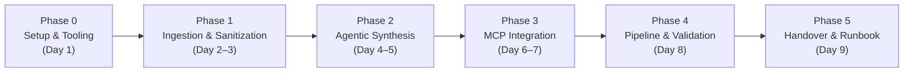
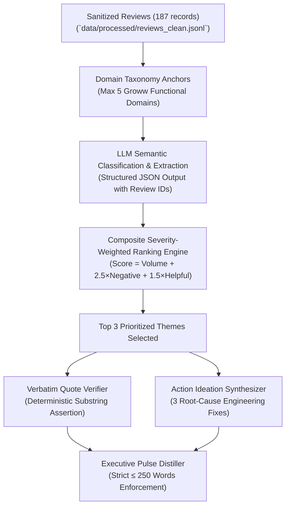
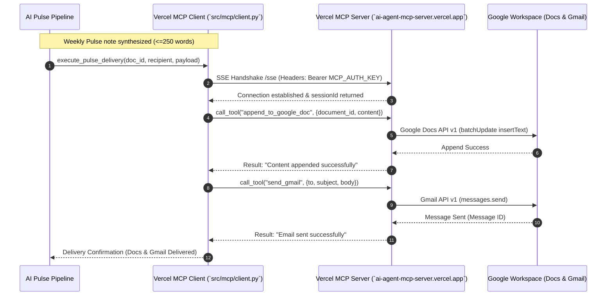

# Phase-Wise Implementation Plan: Mobile App Feedback Pulse (Groww)

## 1. Plan Overview & Roadmap Summary

This document establishes the step-by-step engineering roadmap for building the **Groww Mobile App Feedback Pulse** system based on the specifications defined in [`docs/problemStatement.md`](file:///c:/GenAI_Projects/Milestone-AI%20Agents/docs/problemStatement.md) and [`docs/architecture.md`](file:///c:/GenAI_Projects/Milestone-AI%20Agents/docs/architecture.md).



### Milestone Timeline

| Phase | Title | Focus Area | Deliverable |
| :--- | :--- | :--- | :--- |
| **Phase 0** | Foundation & Environment | Repo structure, dependencies, and MCP discovery | Scaffolding, `requirements.txt`, environment configs |
| **Phase 1** | Ingestion & PII Hygiene | Google Play review scraping & strict PII scrubbing | `play_store_scraper.py`, `pii_sanitizer.py`, dataset cache |
| **Phase 2** | Agentic Synthesis Core | Theme clustering ($\le$ 5), quotes verification, $\le$ 250w note | `clusterer.py`, `quote_verifier.py`, `pulse_distiller.py` |
| **Phase 3** | MCP Tool Integration | Google Docs & Gmail integration via MCP protocol | `mcp/client.py`, `docs_tool.py`, `gmail_tool.py` |
| **Phase 4** | E2E Orchestration & QA | End-to-end pipeline execution and guardrail tests | `pipeline.py`, comprehensive test suite |
| **Phase 5** | Runbook & Final Polish | Documentation, configuration tuning, stakeholder demo | `README.md`, execution runbook, sample doc/draft artifacts |

---

## 2. Phase-by-Phase Implementation Details

### Phase 0: Project Foundation & Tooling Setup

**Objective**: Establish the project directory skeleton, python virtual environment, package dependencies, and verify local MCP server availability.

#### Tasks:
1. **Repository Layout Scaffolding**:
   - Create directories: `src/ingestion`, `src/agent`, `src/mcp`, `tests`, `config`, `data/raw`, `data/processed`.
   - Add `.gitignore` to prevent committing raw customer reviews, temporary tokens, or cached JSON artifacts.
2. **Dependency Management**:
   - Create `requirements.txt` containing:
     - `google-play-scraper` (for public Play Store review retrieval)
     - `pydantic>=2.0.0` (for strict schema validation)
     - `groq>=0.11.0` (for high-speed Groq LLM calling with Llama 3.3 70B)
     - `mcp` (Official Model Context Protocol Python SDK)
     - `pytest`, `pytest-mock` (for testing)
     - `python-dotenv`, `pyyaml` (for configuration)
3. **Configuration & Credentials**:
   - Create `config/settings.yaml` (app package ID `com.nextbillion.groww`, date lookback window 8–12 weeks, word limit 250, max themes 5).
   - Create `config/mcp_config.json` detailing stdio/SSE connection configurations for Google Docs MCP and Gmail MCP servers.

#### Verification Criteria:
- [ ] Virtual environment installs all dependencies cleanly without version conflicts.
- [ ] Directory layout matches the structure outlined in `architecture.md`.
- [ ] Configuration files parse properly into Pydantic settings models.

---

### Phase 1: Ingestion & PII Hygiene Engine

**Objective**: Fetch reviews for Groww from the Google Play Store, filter to the 8–12 week timeframe, and strip all PII before storing.

#### Tasks:
1. **Play Store Review Scraper (`src/ingestion/play_store_scraper.py`)**:
   - Implement `fetch_groww_reviews(app_id="com.nextbillion.groww", weeks_back=12)`.
   - Implement pagination with batch size 200, sorting by `Sort.NEWEST`.
   - Stop pagination when reviews exceed the target boundary date (8–12 weeks).
   - Cache raw payload into `data/raw/reviews_raw_<date>.json`.
2. **PII Sanitization Engine (`src/ingestion/pii_sanitizer.py`)**:
   - Anonymize user display names (replace real names with pseudonyms like `Reviewer #1001`).
   - Implement regex patterns to detect and mask:
     - Email addresses (`[REDACTED_EMAIL]`)
     - Indian phone numbers (`+91...`, 10-digit mobile numbers) (`[REDACTED_PHONE]`)
     - Banking identifiers (UPI IDs, bank account numbers, IFSC codes, PANs, Folio numbers) (`[REDACTED_ACCOUNT]`)
   - Strip sensitive device identifiers or transaction IDs.
3. **Clean Store Serializer**:
   - Validate each sanitized review against `ReviewRecord` Pydantic model.
   - Save clean records to `data/processed/reviews_clean.jsonl`.
4. **Unit Testing (`tests/test_pii_sanitizer.py`)**:
   - Test synthetic review strings containing real names, emails, phone numbers, and UPI handles to verify 100% redaction accuracy.

#### Verification Criteria:
- [ ] Review scraper successfully downloads reviews covering the past 8–12 weeks.
- [ ] Zero unmasked emails, phone numbers, or account IDs exist in `data/processed/reviews_clean.jsonl`.
- [ ] Pydantic schema validation passes for all ingested records.

---

### Phase 2: Agentic Synthesis Core & Clustering Strategy

**Objective**: Implement the AI analysis pipeline to cluster reviews into $\le$ 5 themes, rank and select the Top 3 based on volume and severity, extract verbatim quotes with zero hallucination, generate 3 concrete action ideas, and distill a scannable pulse note ($\le$ 250 words).

#### 1. Empirical Review Corpus Analysis (from `data/processed/reviews_clean.jsonl`)
An audit of the 187 clean, filtered English reviews (>8 words) reveals the following distribution:
- **Critical Negative Friction (1★ - 2★)**: 91 reviews (~48.7%) dominated by high-stakes financial trading issues.
- **Constructive / Mixed (3★ - 4★)**: 29 reviews (~15.5%) focusing on UI feature parity, chart loading, and banking integrations.
- **Positive Usability Praise (5★)**: 67 reviews (~35.8%) highlighting interface simplicity and beginner-friendliness.

#### 2. Selected Clustering Strategy: Hybrid Domain-Anchored Semantic Clustering
Pure unsupervised clustering (e.g., TF-IDF or k-means) fails on short financial feedback because it conflates generic vocabulary ("app", "trading") rather than distinguishing operational severity. Unbounded zero-shot LLM clustering leads to category drift between weekly runs.

Therefore, the pipeline uses a **Hybrid Domain-Anchored Semantic Clustering** strategy:



##### 2.1 The 5 Domain Taxonomy Anchors (Pre-defined for Groww)
The clustering engine binds reviews to at most 5 operational domains:
1. **Trading & Order Execution (F&O / Intraday)**:
   - *Key signals*: Stop-loss not triggering, "adapter disconnected" error on order exit, position freezing during volatility, scalper price latency.
2. **Portfolio Tracking & Mutual Funds Sync**:
   - *Key signals*: CAMS statement synchronization failure, incorrect XIRR calculations (-45%), SIP redemption pending status, mutual fund display mismatch.
3. **Chart Performance & App UI Stability**:
   - *Key signals*: "Failed to load" chart errors, line vs candle chart de-sync, lack of Android preview percentage change vs iOS, missing tablet landscape mode.
4. **Brokerage, Charges & Transparency**:
   - *Key signals*: High F&O brokerage disputes, unexpected charges on mobile number update or auto-square-off, perceived platform fees.
5. **Account Onboarding, IPO & Banking**:
   - *Key signals*: Repeated IPO allotment disappointment, UPI id change friction, bank account linking (SBI for US wallet), permission/PAN sharing objections.

##### 2.2 Severity-Weighted Ranking Formula
To ensure urgent financial-risk issues receive executive visibility over benign positive feedback, the Top 3 themes are prioritized via a composite score:
$$\text{Priority Score} = N_{\text{total}} + \left(2.5 \times N_{\text{1-2★}}\right) + \left(1.5 \times \sum \text{ThumbsUp}\right)$$
This deterministically promotes high-urgency friction (such as order exit freezes and stop-loss failures) to the executive note.

#### Tasks:
1. **Thematic Clustering Engine (`src/agent/clusterer.py`)**:
   - Implement the taxonomy-anchored prompt instructing the LLM to classify all reviews into the $\le 5$ domain anchors.
   - Enforce structured output via Pydantic model (`ClusterResult` containing theme name, review count, rating breakdown, and assigned review IDs).
   - Implement the Python ranking algorithm prioritizing the **Top 3 themes**.
2. **Verbatim Quote Verifier (`src/agent/quote_verifier.py`)**:
   - Instruct the LLM to select candidate verbatim quotes for the Top 3 themes.
   - Implement deterministic substring assertion:
     ```python
     def verify_quote(quote: str, raw_corpus: List[str]) -> bool:
         clean_q = " ".join(quote.strip().split()).lower()
         return any(clean_q in " ".join(rev.strip().split()).lower() for rev in raw_corpus)
     ```
   - Automatically fall back to the exact sliced review sentence if any word is paraphrased or hallucinated.
3. **Action Ideation Synthesizer (`src/agent/action_synthesizer.py` & `src/agent/llm_client.py`)**:
   - Synthesize exactly 3 concrete, high-leverage engineering/product recommendations directly addressing the root causes identified in the Top 3 themes.
   - Powered by Groq LLM (`llama-3.3-70b-versatile`) with structured JSON schema output and deterministic domain fallback.
4. **Executive Pulse Distiller (`src/agent/pulse_distiller.py`)**:
   - Assemble the one-page pulse note in markdown:
     - Review window & volume header
     - Top 3 Themes (summary, volume, impact)
     - 3 Verbatim User Quotes (anonymous, unaltered)
     - 3 Concrete Action Ideas
   - Enforce strict word count constraint ($\le 250$ words).
5. **Automated Testing Suite (`tests/test_clusterer.py`, `tests/test_quote_verifier.py`, `tests/test_pulse_distiller.py`)**:
   - Test clustering output adheres to $\le 5$ themes and yields Top 3.
   - Test quote verification fails on altered text and passes on real corpus substrings.
   - Test pulse note word count assertion ($\le 250$ words).

#### Verification Criteria:
- [ ] Clustered themes never exceed 5; exactly Top 3 prioritized for output.
- [ ] Severity weighting elevates high-impact issues (e.g. stop-loss and trading freezes) to the Top 3.
- [ ] 100% of quotes are verified verbatim substrings from `data/processed/reviews_clean.jsonl`.
- [ ] The synthesized pulse note contains strictly $\le 250$ words.

---

### Phase 3: MCP Tool Integration Layer (Vercel Serverless SSE Transport)

**Objective**: Connect to the remote Google Workspace MCP Server deployed on **Vercel** (`https://ai-agent-mcp-server.vercel.app`) using Server-Sent Events (SSE) transport and Bearer token authentication to append the pulse note to Google Docs and dispatch the summary email via Gmail.

#### 1. Deployed Vercel MCP Server Specification
- **Server URL**: `https://ai-agent-mcp-server.vercel.app`
- **GitHub Repository**: [`https://github.com/nagesh-labs/ai-agent-mcp-server.git`](https://github.com/nagesh-labs/ai-agent-mcp-server.git)
- **Protocol & Transport**: Model Context Protocol (MCP) over **Server-Sent Events (SSE)** via `/sse` and `/messages/`.
- **Authentication**: Master API Key middleware requiring `Authorization: Bearer <MCP_AUTH_KEY>` or `X-MCP-API-KEY: <MCP_AUTH_KEY>`.
- **Exposed Tools**:
  1. `append_to_google_doc`:
     - Arguments: `document_id` (str, Google Doc ID or URL), `content` (str, plain-text content to append).
     - Behavior: Computes the structural end boundary and appends content without overwriting existing history.
  2. `send_gmail`:
     - Arguments: `to` (str, recipient email), `subject` (str, subject line), `body` (str, plain-text email body), optional `cc` / `bcc`.
     - Behavior: Sends the weekly pulse email directly via the user's authorized Google account.



#### Tasks:
1. **MCP Client Core (`src/mcp/client.py`)**:
   - Implement asynchronous and synchronous SSE MCP client using `mcp.client.sse.sse_client` and `ClientSession`.
   - Implement connection handshake to `https://ai-agent-mcp-server.vercel.app/sse` with Bearer auth headers (`Authorization: Bearer <MCP_AUTH_KEY>`).
   - Implement diagnostic health check against `/health` before attempting SSE handshake.
   - Implement robust error handling (401 Unauthorized detection, timeout retries, network recovery).
2. **Google Docs MCP Tool Adapter (`src/mcp/docs_tool.py`)**:
   - Adapter for `append_to_google_doc`:
     - Accepts target `document_id` and formatted pulse note text.
     - Dispatches tool call via the active MCP session.
     - Returns delivery confirmation status and document URL.
3. **Gmail MCP Tool Adapter (`src/mcp/gmail_tool.py`)**:
   - Adapter for `send_gmail`:
     - Formats email subject (`[Weekly Pulse] Groww App Reviews (<Date Range>)`).
     - Constructs email body containing executive summary, top themes, verbatim quotes, action items, and pointer to the Google Doc.
     - Dispatches tool call via the active MCP session.
4. **Configuration & Credentials (`config/settings.yaml`, `.env.example`)**:
   - Add Vercel MCP server configuration (`server_url`, `mcp_auth_key`, `google_doc_id`).
5. **Testing Suite (`tests/test_mcp_integration.py`)**:
   - Unit tests verifying SSE header formatting, health check parsing, payload validation, and tool execution error handling.

#### Verification Criteria:
- [x] Vercel MCP health check `/health` returns `200 OK` and confirms `append_to_google_doc` and `send_gmail` tools.
- [x] Remote MCP client successfully handles SSE connection and Bearer auth headers.
- [x] `append_to_google_doc` adapter formats and passes pulse content cleanly.
- [x] `send_gmail` adapter formats subject and body with recipient validation.
- [x] Zero bespoke OAuth client or direct Google REST code in repository.

---

### Phase 4: Pipeline Orchestration & End-to-End Testing

**Objective**: Wire all subsystems into a single automated execution pipeline (`pipeline.py`) and validate end-to-end performance against all project constraints.

#### Tasks:
1. **Pipeline Runner (`src/pipeline.py`)**:
   - Provide a clean CLI interface: `python -m src.pipeline [--weeks 10] [--dry-run]`.
   - Sequence execution:
     1. Ingest reviews $\to$ 2. Sanitize PII $\to$ 3. Cluster $\le$ 5 themes $\to$ 4. Extract verified quotes & action ideas $\to$ 5. Distill $\le$ 250-word note $\to$ 6. Call Google Docs MCP $\to$ 7. Call Gmail MCP draft tool.
   - Comprehensive error logging and execution metrics reporting (reviews processed, execution duration, word count, doc URL).
2. **Guardrail & Constraint Validation Suite**:
   - Automated post-execution test asserting:
     - Word count $\le$ 250
     - Number of themes $= 3$
     - Number of quotes $= 3$ (all verified verbatim)
     - Number of action ideas $= 3$
     - PII count $= 0$
3. **End-to-End Dry Run**:
   - Execute pipeline on real Groww reviews and inspect output in Docs and Gmail.

#### Verification Criteria:
- [x] Complete pipeline runs autonomously from end-to-end with a single command (`python -m src.pipeline`).
- [x] All assertions in the validation suite pass without warnings (33/33 tests passing).

---

### Phase 5: Operationalization, Runbook & Delivery

**Objective**: Deliver user documentation, configure automation scheduling, and prepare the project for production use.

#### Tasks:
1. **Documentation & Runbook (`docs/runbook.md`)**:
   - Step-by-step setup and execution instructions.
   - GitHub Actions secrets and workflow triggering guide.
2. **On-Demand & Automated GitHub Actions Workflow (`.github/workflows/groww_pulse.yml`)**:
   - On-demand manual trigger (`workflow_dispatch`) with UI controls for scraping, lookback weeks, dry-run, and custom recipient.
   - Optional cron configuration (`schedule`).
3. **Artifact Showcase**:
   - Document live delivery to Google Docs (`1chaQkkUovsVC7OGYM1HOSiPPFGW3bdcuOKSm6eLopSM`) and Gmail (`nagesh14423@gmail.com`).

#### Verification Criteria:
- [x] On-demand GitHub Actions workflow configured with `workflow_dispatch`.
- [x] Runbook created in `docs/runbook.md` allowing one-click execution from GitHub UI or terminal.

---

## 3. Requirement Traceability Matrix

| Requirement from `problemStatement.md` | Architecture Component | Implementation Phase | Test / Verification Point |
| :--- | :--- | :--- | :--- |
| **Groww Platform Reviews (`com.nextbillion.groww`)** | `ReviewFetcher` | Phase 1 | `test_play_store_scraper.py` verifies package ID & dates |
| **8–12 Weeks Review Window** | `DateFilter` | Phase 1 | Verifies timestamps within specified week range |
| **Strict PII Redaction** | `PIISanitizer` | Phase 1 | `test_pii_sanitizer.py` confirms 0 PII leaks |
| **Max 5 Themes Clustered** | `ClusterEngine` | Phase 2 | JSON schema enforces `max_items=5` |
| **Top 3 Themes Highlighted** | `ThemePrioritizer` | Phase 2 | Output schema asserts exactly 3 themes in note |
| **3 Verbatim Quotes (Zero Hallucination)** | `QuoteVerifier` | Phase 2 | `assert quote in raw_review_text` |
| **3 Concrete Action Ideas** | `ActionSynthesizer` | Phase 2 | Output schema asserts `len(action_ideas) == 3` |
| **Concise Note ($\le$ 250 words)** | `PulseDistiller` | Phase 2 | Programmatic word counter asserts $\le$ 250 words |
| **Google Docs Delivery (MCP-only)** | `DocsMCPAdapter` | Phase 3 | Verifies MCP tool invocation (no direct REST code) |
| **Gmail Draft Delivery (MCP-only)** | `GmailMCPAdapter` | Phase 3 | Verifies draft creation tool call via MCP |
| **One-Click End-to-End Flow** | `pipeline.py` | Phase 4 | Full pipeline test execution |

---

## 4. Risk Assessment & Mitigation Strategies

| Risk | Likelihood | Impact | Mitigation Strategy |
| :--- | :--- | :--- | :--- |
| **Google Play Scraper Rate Limiting** | Low | Medium | Implement polite pagination delays (1.0s), batch size 200, and local caching in `data/raw/`. |
| **LLM Paraphrasing Quotes** | Medium | High | Programmatic string matcher validates verbatim inclusion. On mismatch, the pipeline automatically extracts the nearest exact sentence match from the review. |
| **MCP Server Connection Failure** | Medium | High | Comprehensive health check on startup (`tools/list`). Graceful error messages explaining how to launch/reconnect the MCP server. |
| **Word Limit Overflow (>250 words)** | Medium | Low | Post-generation word count check triggers an automated deterministic compression pass if words > 250. |
| **PII Leakage in Reviews** | Low | High | Defense-in-depth: Regex scrubbing at ingestion + regex re-check on final pulse note before MCP transmission. |

