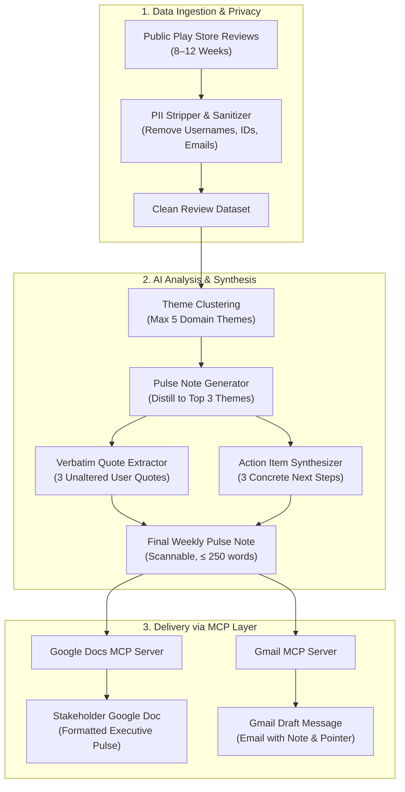

# Project Problem Statement: Mobile App Feedback Pulse (Groww)

## 1. Executive Summary

Mobile app reviews on Google Play Store and Apple App Store contain critical, timely signals about product health, user friction, and customer sentiment. However, teams often struggle to extract actionable insights because manual scanning of thousands of unstructured reviews is time-prohibitive.

The goal of this project is to build an autonomous AI Agent pipeline tailored for the **Groww** platform ([Groww: Stocks, Mutual Fund, IPO on Google Play](https://play.google.com/store/apps/details?id=com.nextbillion.groww&hl=en_IN)). The system continuously ingests raw public app reviews, clusters them into distinct themes, synthesizes a scannable weekly one-page pulse note, and automatically distributes the insights across familiar enterprise surfaces—**Google Docs** and **Gmail**—leveraging the **Model Context Protocol (MCP)** without bespoke REST/OAuth wiring.

---

## 2. Target Product & Data Source

- **Target App**: Groww – Stocks, Mutual Funds, IPO, UPI & Trading
- **App Package ID**: `com.nextbillion.groww`
- **Store URL**: [https://play.google.com/store/apps/details?id=com.nextbillion.groww&hl=en_IN](https://play.google.com/store/apps/details?id=com.nextbillion.groww&hl=en_IN)
- **Time Horizon**: Ingest reviews from the past **8–12 weeks**
- **Data Attributes Collected**: Rating (1–5 stars), review title, review text, submission date, thumbs-up count, app version.

---

## 3. Stakeholder Value & Target Audience

| Audience | Core Need | Project Impact |
| :--- | :--- | :--- |
| **Product & Growth** | Needs to prioritize roadmap items, bug fixes, and UX friction points based on real user volume and urgency. | Direct visibility into emerging blockers and user expectations derived from real store signals. |
| **Customer Support** | Needs to align support playbooks, FAQs, and messaging with trending user complaints. | Proactive awareness of recurring issues (e.g., KYC delays, payment gateway drops). |
| **Leadership** | Needs an executive summary of app health without drowning in raw feedback. | High-signal, one-page weekly health check readable in under 2 minutes. |

---

## 4. End-to-End Workflow & Pipeline Architecture

---

## 5. What "Done" Looks Like (Core Deliverables)

### 5.1 Weekly One-Page Pulse Note
A scannable, highly distilled document strictly adhering to:
1. **Length**: Concise and scannable (target **≤ 250 words**).
2. **Top 3 Themes**: Selected from a maximum of 5 clustered themes (e.g., Onboarding/KYC, Order Execution & Trading, Payment/Deposit/Withdrawal, Charges/Brokerage, App Stability/UI).
3. **3 Verbatim User Quotes**: Exact real snippets from user reviews with zero altered or hallucinated wording.
4. **3 Action Ideas**: Pragmatic, concrete engineering/product next steps directly grounded in the identified themes.

### 5.2 Delivery Artifacts (MCP-First)
1. **Google Doc**: Created or updated automatically via the Google Docs MCP server.
2. **Gmail Draft**: A ready-to-send draft email generated automatically via the Gmail MCP server containing the pulse summary and linking to the Google Doc.

---

## 6. Technical Requirements & Integrations

### 6.1 MCP-First Integration (Zero Bespoke OAuth/REST Plumbing)
- **Architecture Mandate**: All interactions with Google Docs and Gmail must occur through **Model Context Protocol (MCP)** servers/tools.
- **Rule**: Do not write bespoke Google API OAuth clients, token refresh routines, or low-level HTTP REST requests. The AI agent connects to designated MCP servers exposing Docs and Gmail tool primitives.

### 6.2 Data Ingestion & Ethical Guidelines
- **Public Exports Only**: Rely exclusively on public store exports or standard store scrapers (e.g., `google-play-scraper`).
- **No Scraping Violations**: No authenticated store scraping or actions violating Play Store Terms of Service (ToS).

### 6.3 Clustering & Theming Limits
- **Max Themes**: The clustering model must group reviews into at most **5 overarching themes**.
- **Focus**: The generated pulse highlights only the **Top 3 themes** representing the highest volume or highest severity issues.

### 6.4 Privacy & Governance (Strict PII Redaction)
- **Zero Personally Identifiable Information (PII)**: All reviewer usernames, email addresses, phone numbers, account identifiers, device IDs, or personal references must be scrubbed before processing and delivery.
- Quotes displayed in the Google Doc and Gmail draft must be completely anonymous.

---

## 7. Success Criteria & Quality Checklist

- [ ] **Data Pipeline**: Successfully fetches Groww app reviews spanning the prior 8–12 weeks.
- [ ] **PII Compliance**: No reviewer names, emails, or personal identifiers present in prompts or outputs.
- [ ] **Clustering**: Max 5 macro-themes identified; Top 3 prioritized for output.
- [ ] **Synthesis Quality**: Note is strictly $\le$ 250 words, contains exactly 3 authentic verbatim quotes, and 3 actionable recommendations.
- [ ] **MCP Google Docs**: Document created/updated seamlessly via MCP tool call.
- [ ] **MCP Gmail**: Draft email created in Gmail with proper formatting and document link via MCP tool call.

