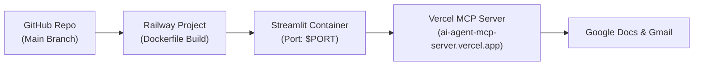

# Operational Runbook: Interactive Web Dashboard & Railway Deployment

This guide covers running the **Groww Mobile App Feedback Pulse** interactive Streamlit dashboard locally, deploying it to **Railway**, and triggering delivery via Web UI or GitHub Actions.

---

## 1. Interactive Web Dashboard Overview

The dashboard (`src/app.py`) provides a complete visual command center for the feedback pulse agent:
- **Real-Time KPIs**: Total clean reviews (187), critical friction volume (1-2★), positive praise, and word count adherence ($\le 250$ words).
- **Executive Pulse & Delivery Tab**: Click "Run Synthesis & Deliver" to generate the report and append to Google Docs & send Gmail via the remote Vercel MCP server.
- **Thematic Analytics Tab**: Interactive Plotly charts ranking the 5 taxonomy themes by composite severity score and star rating breakdowns.
- **Verified User Voices Tab**: Verbatim quotes with exact review text, reviewer pseudonym, and 100% verified substring checks.
- **Review Corpus Explorer Tab**: Searchable and filterable table of the sanitized customer reviews.

### Local Dashboard Testing
Run the dashboard locally from your project directory:

```powershell
.\.venv\Scripts\streamlit.exe run src/app.py
```
Open your browser at `http://localhost:8501`.

---

## 2. Deploying to Railway

Railway runs the application in a Docker container using the included `Dockerfile` and `railway.json`.



### Method A: Deploy via Railway Dashboard (Recommended)

1. **Push your code to GitHub**:
   ```powershell
   git init
   git branch -M main
   git add .
   git commit -m "feat: add interactive Streamlit dashboard and Railway deployment configuration"
   git remote add origin https://github.com/<your-username>/groww-feedback-pulse-agent.git
   git push -u origin main
   ```

2. **Create New Project on Railway**:
   - Go to [railway.com](https://railway.com) and log in.
   - Click **+ New Project** $\to$ Select **Deploy from GitHub repo**.
   - Choose your repository `groww-feedback-pulse-agent`.

3. **Configure Environment Variables in Railway**:
   - In your Railway project, navigate to the **Variables** tab.
   - Add the following environment variables:

| Variable Name | Example Value | Purpose |
| :--- | :--- | :--- |
| `GROQ_API_KEY` | `gsk_...` | Groq Cloud API Key for Llama 3.3 70B |
| `MCP_AUTH_KEY` | `nagesh` | Master key for Vercel MCP server |
| `GOOGLE_DOC_ID` | `1chaQkkUovsVC7OGYM1HOSiPPFGW3bdcuOKSm6eLopSM` | Target Google Doc ID |
| `PULSE_EMAIL_RECIPIENT` | `nagesh14423@gmail.com` | Target recipient email address |
| `MCP_SERVER_URL` | `https://ai-agent-mcp-server.vercel.app/sse` | MCP SSE endpoint |
| `MCP_HEALTH_URL` | `https://ai-agent-mcp-server.vercel.app/health` | MCP Health endpoint |

4. **Generate Public Domain**:
   - In your Railway service $\to$ **Settings** $\to$ **Networking** $\to$ Click **Generate Domain**.
   - Railway will provide a live URL like `https://groww-feedback-pulse-production.up.railway.app`.
   - Open this URL in any browser to access the interactive dashboard!

---

### Method B: Deploy via Railway CLI

If you prefer using the command line:

```powershell
# 1. Install Railway CLI (via npm or scoop/brew)
npm i -g @railway/cli

# 2. Login to Railway
railway login

# 3. Link and Deploy
railway init
railway up
```

---

## 3. On-Demand Execution via GitHub Actions (Alternative)

If you also want to run the pipeline without opening the web dashboard:
1. Open your GitHub repository $\to$ **Actions** tab.
2. Select **"Generate Groww Feedback Pulse"**.
3. Click **Run workflow**.

---

## 4. Local CLI Execution (Alternative)

```powershell
# Run using cached reviews
.\.venv\Scripts\python.exe -m src.pipeline

# Run with live scraping from Play Store
.\.venv\Scripts\python.exe -m src.pipeline --scrape --weeks 10

# Run in dry-run mode
.\.venv\Scripts\python.exe -m src.pipeline --dry-run
```
